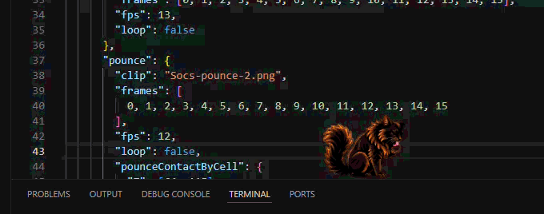
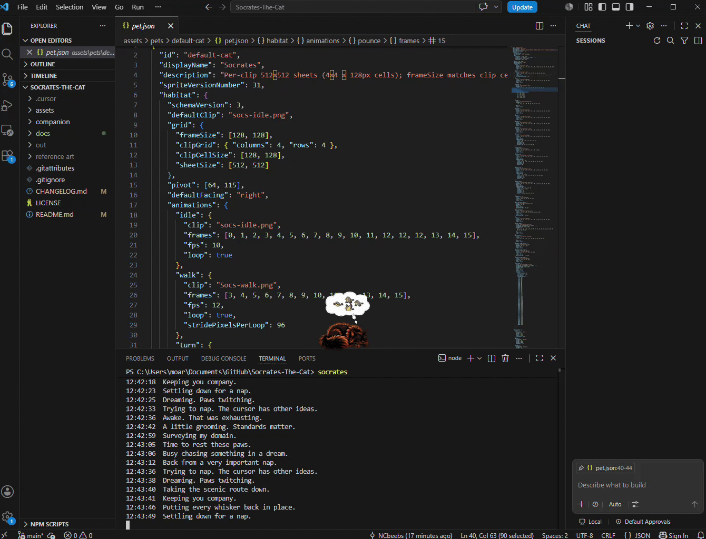
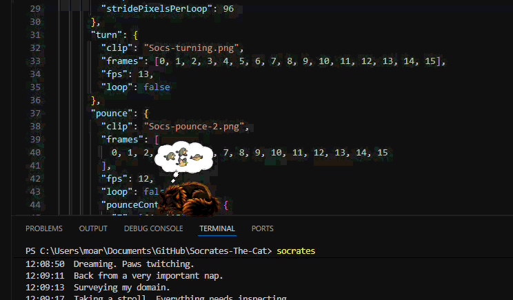

# Socrates the Cat

A desktop cat that walks the real tab strips, panel edges, and status bar in **VS Code or Cursor**. He grooms, sleeps, dreams, follows your pointer, and falls when his ledge disappears. The overlay is click-through so you can keep working.

**Windows source preview.** There is no published installer or IDE extension yet. Built with **Tauri 2, Rust, TypeScript 6, Vite 8, and Windows UI Automation**.

## Demo



**Pointer play** (Cursor always clicks-through to IDE):



**Portal hop** (rare—emerges on another walkable ledge):



He also walks and turns at ledge ends, stretches, grooms, sits and looks at the pointer, clings to moving horizontal splits, and slides down dividers. Activities and clips are in [`pet.json`](assets/pets/default-cat/pet.json).

## Requirements

| Component | Requirement |
|---|---|
| OS / IDE | Windows 10/11 with [VS Code](https://code.visualstudio.com/) or [Cursor](https://cursor.com/) |
| Node.js | [Node 24 LTS](https://nodejs.org/en/download) recommended; Node 22.12+ also meets the build and test requirements |
| Rust | Stable **MSVC** toolchain via [rustup](https://rustup.rs/); `cargo` on your `PATH` |
| Windows build tools | Microsoft C++ Build Tools with **Desktop development with C++**, Windows SDK, and **WebView2 Runtime** |
| Git | Required for the clone command below |

Follow the [Tauri Windows prerequisites](https://v2.tauri.app/start/prerequisites/#windows). Keep Node, Rust, and WebView2 updated. Node 20 is [end of life](https://nodejs.org/en/about/previous-releases).

## Install and run

Run these commands in the integrated terminal of the IDE where you want Socrates:

```powershell
git clone https://github.com/NCbeebs/Socrates-The-Cat.git
cd Socrates-The-Cat\companion
npm ci
npm start
```

The first launch compiles the native app and can take several minutes. Keep an IDE window focused and the terminal open; press **Ctrl+C** to stop. Socrates follows foreground windows belonging to the launch IDE (all VS Code windows or all Cursor windows) and hides when you switch to another application.

For a command you can run from any directory, run `npm link` once from `companion/`, then use `socrates`. Keep the checkout and development tools installed; this command runs the app from source. If you move the checkout, link it again. Remove the global command with `npm unlink -g companion`.

From an external terminal, select the IDE explicitly:

```powershell
$env:HABITAT_IDE_HOST = "code" # or "cursor"
socrates
```

Without an explicit selection, startup checks process ancestry and defaults to Cursor when no IDE can be identified.

## Diagnostics and troubleshooting

The terminal shows a live activity journal and technical warnings. Run `socrates --debug` or `npm run debug` for a HUD, surface outlines, pointer reach box, and raw development output. See the [debug screenshot](docs/images/debug.png), or use `socrates --help`.

Logs are stored locally under `%LOCALAPPDATA%\Socrates\logs`; the launcher prints the exact directory and session ID. Files rotate at 5 MiB with three backup segments, with cleanup of old logs after 14 days when logging runs. See the [developer guide](companion/README.md) for file names and overrides.

**Review logs and recordings before sharing them.** Raw build output and errors can contain local paths, usernames, and other machine details. Screen recordings can expose editor and terminal contents. Socrates has no application telemetry or upload feature; the development tools may access package registries during installation and builds.

| Symptom | Try |
|---|---|
| `cargo` not found | Add `%USERPROFILE%\.cargo\bin` to `PATH`, then reopen the terminal |
| No cat or wrong IDE | Launch from the intended IDE's terminal; check the `ide_host` journal entry or set `HABITAT_IDE_HOST` |
| `socrates` not found | Run `npm link` from `companion/`; ensure `npm prefix -g` is on `PATH` |
| PowerShell blocks scripts | Use `npm.cmd` and `socrates.cmd` |
| Unexpected HUD or wireframes | Clear `HABITAT_DEBUG*` shell overrides and launch without `--debug` |
| Build or logging failure | Check the reported error, disk space, and directory permissions; `SOCRATES_LOG_DIR` can select another log directory |

## Development

The application is in `companion/`; its required artwork and manifest are in `assets/pets/default-cat/`. Both directories are needed for a source build. Keep both dependency lockfiles for reproducible installs.

From `companion/`:

```powershell
npm test
npm run build
cargo test --locked --manifest-path src-tauri/Cargo.toml
```

`npm run build` builds the frontend only. See [commands and environment settings](companion/README.md), [architecture](docs/architecture.md), and [changelog](CHANGELOG.md) for details.

Issues and PRs are welcome. Bug reports should include Windows and IDE versions, launch command, steps to reproduce, session ID, and relevant **reviewed/redacted** logs. Report suspected security vulnerabilities privately to [generalchromodynamics@protonmail.com](mailto:generalchromodynamics@protonmail.com).

## Roadmap

- Refined animations
- Linux and Mac support

## License and contact

Source code: [MIT](LICENSE). Cat artwork and animation metadata: [artwork license](assets/pets/LICENSE.md), including attribution for public redistribution.

**General Chromodynamics** — [generalchromodynamics.com](https://generalchromodynamics.com/) · [generalchromodynamics@protonmail.com](mailto:generalchromodynamics@protonmail.com)
