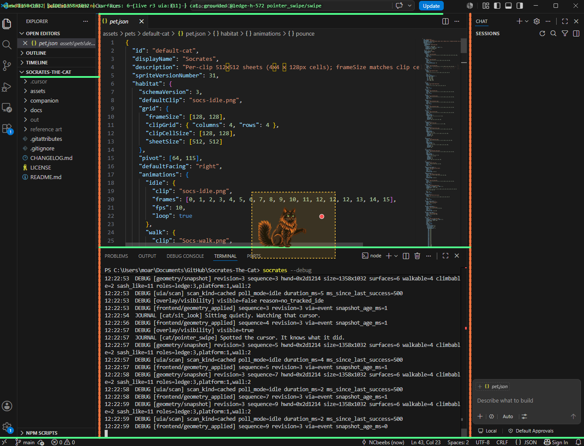

# Socrates the Cat

A layout-aware desktop cat that lives on **VS Code or Cursor** real UI—tab strips, panel edges, and the status bar—not a fixed corner of the screen. He walks those ledges, falls when they move away, grooms, sleeps, dreams, and watches your pointer. The overlay is click-through so you can keep typing.

Built with **Tauri 2**, **Rust**, **TypeScript**, **Vite**, and **Windows UI Automation**.

## Demo


**Pointer play** (read-only—overlay stays click-through):


The clips above focus on **everyday ledge life** and **cursor play**. Socrates also does the following on the real workbench (weighted at random unless noted):

| Kind | What you might see |
|------|---------------------|
| **Movement** | Idle blinks; **walk** along tab strips and panel tops; **turn** at ledge ends. |
| **Idle flavor** | **Groom** (three variants), **stretch**, **sit and look** at the cursor with head tracking. |
| **Sleep** | Optional stretch → curl up → **dream** (birds, mice, or “maximum comfy”) → wake; poke him while napping for an **annoyed** reaction. |
| **Layout** | **Fall** when a ledge disappears; **cling** on a moving horizontal split while you drag it; **slide** down a divider to a lower ledge; rare **portal** hop to another walkable ledge. |
| **Pointer** (tiers) | **Look** and **alert** from farther away; **swipe** and **pounce** when the cursor is very close (see `socrates2.gif`). |

All of this is driven by [`pet.json`](assets/pets/default-cat/pet.json) activities and clips—no extra setup.

## Preview status

**Early preview.** Runs from source on **Windows** with **[VS Code](https://code.visualstudio.com/)** or **[Cursor](https://cursor.com/)**; there is no installer or IDE extension yet. Launch from an integrated terminal in the IDE you want—Socrates follows **that application’s** foreground windows for the session (all VS Code windows, or all Cursor windows—not a single locked HWND).

**Planned:** packaged install, IDE extension, broader layout smoke coverage on VS Code.

## Features

- Stays on surfaces the IDE actually draws—walks, turns at edges, can slide down dividers or take rare portal hops.
- Grooms, sits and looks at the cursor, sleeps, dreams, and gets annoyed if you poke him while he naps.
- Falls when his footing disappears; can hang on horizontal panel splits while you drag them.
- Reacts to the mouse nearby (swipe, pounce, look)—read-only; never moves your cursor or steals clicks.
- Hides when another app is focused; reappears when a window of the **launch IDE** is focused again.
- Keeps a live terminal journal of his activity and saves technical diagnostics when something goes wrong.

## Requirements

| | |
|---|---|
| **OS** | Windows 10/11 |
| **IDE** | [VS Code](https://code.visualstudio.com/) or [Cursor](https://cursor.com/) (launch from that IDE’s integrated terminal) |
| **Node.js** | 20.19+ or 22.12+ for `socrates` / `npm start`; **22+** for `npm test` (TypeScript test imports) |
| **Rust** | Stable via [rustup](https://rustup.rs/), **MSVC** toolchain (`rustup default stable-msvc`) |
| **Windows build** | [Microsoft C++ Build Tools](https://visualstudio.microsoft.com/visual-cpp-build-tools/) (Desktop development with C++), **Windows SDK**, **WebView2** |

Full Windows setup (including WebView2): [Tauri prerequisites — Windows](https://v2.tauri.app/start/prerequisites/#windows).

Put `cargo` on your `PATH` (e.g. `%USERPROFILE%\.cargo\bin`).

## Quick start

From a shell with Rust and Node ready:

```powershell
git clone https://github.com/NCbeebs/Socrates-The-Cat.git
cd Socrates-The-Cat\companion
npm install
npm link
socrates
```

`npm link` registers the `socrates` command once. After that, run `socrates` (or `Socrates` on Windows) from any directory. Keep the checkout in place; the command launches its source using the development toolchain. If you move the checkout, run `npm link` again from its `companion/` directory.

Without global registration, run `npm start` from `companion/` instead.

**What success looks like:** Open **VS Code or Cursor** with a normal layout (sidebar, editor, terminal). Run `socrates` from that IDE’s integrated terminal. Keep an IDE window focused—Socrates should appear on a walkable ledge. Switch to another app and the overlay hides until a window of the same IDE is focused again.

If both VS Code and Cursor are installed, launching from VS Code’s terminal keeps Socrates on VS Code only (and vice versa). From an external terminal, set `HABITAT_IDE_HOST=code` or `cursor`, or rely on auto-detection (defaults to Cursor when ambiguous).

The launch terminal shows his journal as he changes activities. Keep it open for the session.

Pet art and behavior: [`assets/pets/default-cat/`](assets/pets/default-cat/).

## Usage and troubleshooting

Normal runs show a live daily journal in the terminal as Socrates walks, grooms, plays, and naps. Technical warnings and errors appear with diagnostic details. The overlay has no HUD or ledge wireframes. For layout debugging and raw development output:

```powershell
socrates --debug
```

Debug mode draws **walkable ledges** (green), **climbable / vertical edges** (orange), a **yellow box** around the cat’s pointer-reach area, and a **HUD** line (surface count, revision, motion phase, activity). The terminal also shows structured `DEBUG` geometry lines and `JOURNAL` behavior lines alongside the normal activity journal:



Use `socrates --help` for command help. Keep the terminal open while Socrates runs; press **Ctrl+C** to stop. From `companion/`, `npm run debug` also enables diagnostics.

Example journal entries, based on actual activity changes:

```text
SOCRATES' JOURNAL · 2026-10-18
Logs: C:\Users\you\AppData\Local\Socrates\logs

09:02:14  Socrates is ready.
09:05:32  Patrolling the ledge.
09:12:08  Settling down for a nap.
09:14:21  ERROR [surface-mapper] uia fast scan failed
          Technical error details appear here.
```

Entries use authored phrase variations, with a 30-second repetition limit per activity. Repeated runtime errors are summarized, and successful operations report recovery.

| Command | Terminal and overlay |
|---------|----------------------|
| `socrates` / `npm start` | Activity journal and diagnostics; cat overlay |
| `socrates --debug` / `npm run debug` | Journal, diagnostics, raw development output, HUD, and wireframes |
| `npm run tauri:dev` | Direct development output and tagged application records |

Journal and diagnostic files are saved under `%LOCALAPPDATA%\Socrates\logs` (the exact location is printed at startup). Daily journal files append across restarts; launcher events and raw development output have separate session files. Files rotate at 5 MiB with three backup segments, and files older than 14 days are cleaned up during logging. Include the relevant files when reporting an issue. Set `SOCRATES_LOG_DIR` in your shell to choose another location.

Application records are in `journal-YYYY-MM-DD.jsonl`; launcher events are in `launcher-YYYY-MM-DD-SESSION.jsonl`; raw tool output is in `development-YYYY-MM-DD-SESSION.log`.

Optional env vars and developer commands: [companion/README.md](companion/README.md).

| Symptom | Try |
|---------|-----|
| `cargo` not found | Add `%USERPROFILE%\.cargo\bin` to `PATH` |
| No cat | Focus a window of the **launch IDE**; confirm the companion is running; check journal for `ide_host` |
| Cat on wrong IDE | Launch from that IDE’s integrated terminal, or set `HABITAT_IDE_HOST=code` / `cursor` |
| `socrates` not found | Run `npm link` from `companion/`; ensure the directory shown by `npm prefix -g` is on your Windows `PATH`, then reopen the terminal |
| PowerShell says scripts are disabled | Use `npm.cmd` instead of `npm`, and `socrates.cmd` instead of `socrates` |
| HUD/lines when you wanted pet-only | Run `socrates` without `--debug`; clear any `HABITAT_DEBUG*` overrides in your shell |
| Terminal shows Vite/Cargo output instead of the journal | Launch with `socrates` or `npm start`; `tauri:dev` is the direct developer command |
| Startup reports insufficient disk space | Free space on the build drive and retry; the diagnostic log preserves the available build error details |
| Logs cannot be saved | Check free space and directory permissions, or set `SOCRATES_LOG_DIR` to a writable location; terminal reporting continues for native and launcher failures |
| HUD but few or no surfaces | Keep the **launch IDE** focused; try `socrates --debug` and confirm the HUD shows live surfaces |
| Invalid `HABITAT_IDE_HOST` | Use `code`, `cursor`, or `auto`; check journal for `ide_host_invalid` |

## Project layout

```text
README.md, LICENSE, CHANGELOG.md
assets/pets/default-cat/   pet.json + clip PNGs
companion/                 Tauri app and socrates launcher
docs/architecture.md       How geometry, pointer, and logging fit together
docs/images/               Demo GIFs, debug screenshot
```

## Documentation

- [Architecture](docs/architecture.md)
- [Changelog](CHANGELOG.md)
- [Companion env & commands](companion/README.md)

## Roadmap

- Refined animations
- Linux and Mac support

## Contributing

Issues and PRs welcome during pre-release. From `companion/`:

```powershell
npm test
npm run build
```

**Useful bug reports include:** Windows version, **VS Code or Cursor** version, launch IDE (`HABITAT_IDE_HOST` / integrated terminal), steps to reproduce, screenshot or recording, journal/launcher/development logs, and in debug mode the HUD line (e.g. `surfaces: … [live rN …]`).

## Contact

**General Chromodynamics** — [generalchromodynamics.com](https://generalchromodynamics.com/) · [generalchromodynamics@protonmail.com](mailto:generalchromodynamics@protonmail.com)

## License

| | Status |
|---|---|
| **Source code** | [MIT](LICENSE) |
| **Cat artwork** (`assets/pets/`) | [Artwork license](assets/pets/LICENSE.md) — use and modify freely; attribution for public redistributions |
