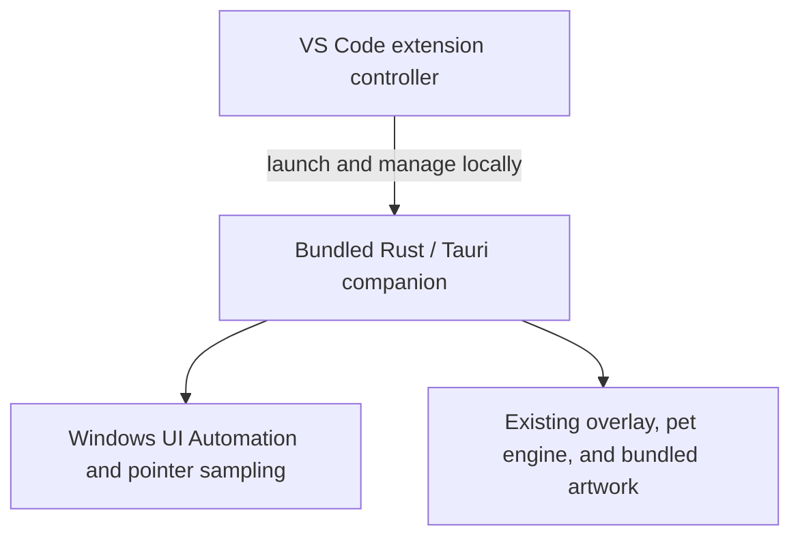

# VS Code extension: research and implementation tracker

**Last updated:** 2026-10-25. **Cleanup baseline:** `423f766` plus the working-tree Phase 7 changes below. **Status: Phase 7 code/artifact audit complete; final release gate pending.** Manual runtime and Marketplace validation remain open; no Marketplace submit without explicit owner OK.

| Phase | Summary | Gate |
|---|---|---|
| 0–1 | Source test baseline; `npm run tauri:build:release`; release `companion.exe` | Passed |
| 2 | `managed_lifecycle.rs` (mutex + pipe v1) | Passed |
| 3 | `extension/` Start / Stop / Show Diagnostics | Passed |
| 4 | `npm run package:win` → VSIX in `extension/stage/` | Passed (local install) |
| 5 | Automated regressions + parity table | Passed (see gaps below) |
| 6 | Release readiness, listing, docs | **Prep complete**; manual Marketplace checks pending |
| 7 | Final cleanup (release blocker) | **Code/artifact audit complete**; manual runtime gates and standard Rust test loading remain open |

**Resume here:** Install the rebuilt VSIX identified in Phase 7 and complete the remaining manual runtime/release checks. Resolve or explicitly disposition the standard Rust loader failure and packaging-tool advisory before publication authorization. Existing listing GIFs still need verification from `main`; additional local screenshots are optional.

**Pre-Marketplace gaps** (recorded in Phase 5 table): remote SSH/WSL UI placement, upgrade/uninstall with multiple windows, clean machine without build tools, formal CPU/timing caps, WebView2-missing UX, **extension developer debug parity** (HUD/wireframes/journal vs clone `socrates --debug` — planned below).

Expanded documentation review: Context7 `/websites/code_visualstudio_api`, `/microsoft/vscode-docs`, and `/tauri-apps/tauri-docs`, cross-checked against the [official API entry point](https://code.visualstudio.com/api). This document is the single implementation tracker; do not create parallel planning documents.

### Quick reference (installed VSIX)

1. **Extensions** → **Install from VSIX** → `extension/stage/socrates-the-cat-*-win32-x64.vsix`
2. **Ctrl+Shift+P** → **Socrates: Start** (cat) / **Stop** / **Show Diagnostics**
3. Clone users: unchanged — `companion/` → `socrates` (extension optional)

## Goal and acceptance boundary

Make Socrates installable through the VS Code Marketplace while preserving the current Windows cat experience: walking on real IDE ledges, falling when support disappears, pointer reactions, click-and-hold carrying, click-through behavior, focus tracking, and all existing animations.

Keep one Rust/Tauri companion, one TypeScript pet engine, and one artwork set. Add a small VS Code extension that distributes and manages a production build of that companion. Identical behavior is the acceptance target, not a verified result of this investigation.

| Environment | Initial scope |
|---|---|
| Windows x64, desktop VS Code | Proposed first extension target; validate supported Windows/VS Code versions before release |
| Windows desktop VS Code connected to SSH, WSL, or a container | Companion must run locally beside the UI; explicitly test this configuration |
| Windows ARM64 | Deferred until a native package and runtime behavior are validated |
| Browser-only VS Code | Outside initial scope; cannot launch the native companion |
| Linux/macOS | Outside initial extension milestone; require working native integrations first |
| Existing Windows source launches in VS Code and Cursor | Preserve as regression targets |
| Cursor extension distribution | Separate compatibility/distribution investigation; not implied by a VS Code Marketplace listing |

Linux research remains in [linux_support.md](linux_support.md). Packaging this application as an extension does not supply missing Linux or macOS window/input APIs.

## Reuse strategy and clone compatibility contract

**Clarified requirement:** preserve the user workflow of cloning from GitHub, installing dependencies, launching Socrates, and using its existing features. Internal code, file organization, and shared helpers may change when needed for a clean extension integration. This is a workflow/behavior compatibility contract, not a freeze on the current implementation. Prefer small shared edits over duplicated implementations, and verify both launch routes after changing shared code.

**Yes: build the existing application as an executable and distribute it through a thin extension.** Tauri already performs the native compilation and frontend embedding. An executable alone is not a VS Code extension: the VSIX also needs a manifest and a JavaScript controller. Packaging needs no replacement renderer or new native framework.

The current developer guide already documents this command, run from `companion/`:

```powershell
npm run tauri:build:release
```

It builds the release application using the existing frontend hook while skipping installer generation (`tauri build --no-bundle`). Prefer this script over `npm run tauri -- build --no-bundle`, which still produced MSI/NSIS in local testing. With the default Cargo target directory and no explicit target triple, expect `companion/src-tauri/target/release/companion.exe`; verify the actual output path rather than hard-coding it across scripts. This command has not been run as part of planning. [Existing build command](companion/README.md), [Tauri distribution](https://v2.tauri.app/distribute/), [Tauri CLI](https://v2.tauri.app/reference/cli/#build).

Required invariants throughout implementation:

- `npm ci`, `npm link`, `socrates`, `npm start`, `socrates --debug`, `socrates --check-updates`, and direct Tauri development commands retain their documented behavior.
- Cloning/running the application does not require installing extension development packages or enabling an extension.
- Preserve existing CLI validation, Ctrl+C handling, journal presentation, log paths/retention, optional update checks, environment precedence, and VS Code/Cursor host detection.
- Reuse the existing pet engine and assets, preserving user-visible animation, geometry, pointer, overlay, and foreground-window behavior. Internal interfaces or organization may change when justified; update all producers/consumers together and verify ordering, timing, and behavior at their integration points.
- Extension lifecycle code activates only through an explicit managed launch option. No managed option means no new server, ownership lock, startup watchdog, or shutdown rule in source launches.
- Extension child environment changes are per-process; never mutate the user's shell, global environment, git configuration, or source-launch defaults.
- Building/packaging must not rewrite the pet manifest, shared source configuration, source package version, or repository artwork.
- Source tooling is supported code, not legacy merely because it is excluded from a VSIX. Keep it tested and reachable. Remove obsolete implementation paths only after their callers are migrated and both supported launch routes pass.

Functional equivalence means matching user-visible behavior on equivalent Windows/IDE configurations. The source workflow still builds through Vite/Cargo; an installed extension uses prebuilt output. Installation, activation, and **extension orchestration diagnostics** can differ without changing the cat's behavior. **Developer debug presentation** (HUD, ledge wireframes, pointer reach box) is intentionally out of scope for Phase 3 v1 but is a documented follow-on so contributors are not forced to choose between the VSIX and `socrates --debug`.

## Extension developer debug parity (planned)

**Status:** Implemented in extension **0.1.2** (2026-10-25). **Show Diagnostics ≠ clone terminal debug** (still true — no Cargo/Vite journal). Today the extension only exposes pipe attach state and paths (`extension/src/extension.ts`); managed spawn uses `companion.exe --habitat-managed` with `stdio: "ignore"` and does not set `HABITAT_DEBUG*` (`extension/src/session.ts`). Clone `socrates --debug` sets `HABITAT_DEBUG=1` and `HABITAT_DEBUG_LOG=1` and pipes child stdout for a live terminal journal (`companion/bin/socrates.js`). The native overlay flags are resolved once at process start (`companion/src-tauri/src/habitat_config.rs` → `get_habitat_presentation` in the WebView).

### What “parity” should mean (tiered)

| Tier | Clone `socrates --debug` | Extension today | Extension target |
|---|---|---|---|
| **A — Overlay** | HUD, surface outlines, yellow reach box | Off (pet mode); red reach dot only in normal presentation | User-controlled on managed Start |
| **B — Structured diagnostics** | `debug` records in terminal journal | Written under `%LOCALAPPDATA%\Socrates\logs\vscode-managed` if enabled, but not surfaced in VS Code | Optional tail into **Socrates** output channel |
| **C — Raw dev tool output** | Cargo/Vite lines when launcher runs `tauri dev` | N/A (release `companion.exe` only) | **Non-goal** for VSIX; keep clone/Tauri dev paths |

Tier **A** is the minimum meaningful parity for layout debugging. Tier **B** closes the gap between “debug exists on disk” and “I can see it while using the extension.” Tier **C** stays source-only.

### UX proposal (VS Code)

Prefer **user-scoped settings** with `scope: "application"` ([configuration scope](https://code.visualstudio.com/api/references/contribution-points#scope)) plus clear restart semantics.

**Setting IDs (no prefix conflicts):** A setting ID cannot be a complete prefix of another ([`contributes.configuration`](https://code.visualstudio.com/api/references/contribution-points#contributes.configuration)). Do **not** use both `socrates.debug` and `socrates.debug.*`. Use **leaf** keys only:

| Setting ID | Type | Default | Purpose |
|---|---|---|---|
| `socrates.debug.enabled` | `boolean` | `false` | Umbrella: `--debug` argv + `HABITAT_DEBUG=1` on the **next** spawn this window initiates |
| `socrates.debug.surfaces` | `boolean` \| `null` | `null` | When non-null, explicit `HABITAT_DEBUG_SURFACES`; when `null`, inherit from `enabled` |
| `socrates.debug.hud` | `boolean` \| `null` | `null` | When non-null, explicit `HABITAT_DEBUG_HUD`; when `null`, inherit from `enabled` |
| `socrates.debug.streamJournal` | `boolean` \| `null` | `null` | Tier B: extension tails JSONL into the output channel when effective; when `null`, inherit from `enabled` |

**Resolution (extension → spawn):**

```text
effectiveSurfaces      = surfaces ?? enabled
effectiveHud           = hud ?? enabled
effectiveStreamJournal = streamJournal ?? enabled
effectiveDebugLog      = enabled || effectiveStreamJournal
```

- **`HABITAT_DEBUG_LOG`:** set to `1` when `effectiveDebugLog` is true, else `0` (after scrub). Native structured `debug` records in `journal-*.jsonl` follow this flag (`habitat_config.rs` / `debug_log()`).
- **`streamJournal` vs logging:** `effectiveStreamJournal` gates only the **extension’s journal reader** (tier B output channel). `effectiveDebugLog` gates **native** verbose records. Stream-only mode (`enabled: false`, `streamJournal: true`) turns on logging without overlay; full debug with streaming off (`enabled: true`, `streamJournal: false`) keeps native debug records without tailing to VS Code.
- **`enabled` false, all subflags `null`:** pet mode (no `--debug`, all four env keys off after scrub).
- **Subflags when `enabled` is false:** a **non-null** subflag is an explicit override and **may** enable that facet without turning on the full umbrella (e.g. `enabled: false`, `surfaces: true` → set only `HABITAT_DEBUG_SURFACES=1`, no `--debug`, no `HABITAT_DEBUG`). This matches native `resolve_subflag` in `habitat_config.rs`. **`null` subflags never imply on when `enabled` is false.**
- **`enabled` true:** append `--debug` and set `HABITAT_DEBUG=1`; apply non-null `surfaces` / `hud` as `1`/`0`, nulls inherit `true` for surfaces/hud unless explicitly set false; apply `HABITAT_DEBUG_LOG` from `effectiveDebugLog` as above.

Optional command (nice-to-have, not required for tier A): **Socrates: Start (debug)** — one-shot Start with resolved flags as if `enabled` were true for that spawn only (still requires **Stop** if a shared managed instance is already running).

**Semantics:**

- Presentation is fixed at companion process start. **Stop** shuts down the **shared** managed companion for all attached VS Code windows; then change settings and **Start** again (or implement Stop→Start in a toggle command later). Document this in extension README.
- Toggling settings while attached should use `workspace.onDidChangeConfiguration` to warn that changes apply to the **next spawn**, not the running process.
- **Show Diagnostics** remains orchestration-only (pipe, paths, attach). See [Effective vs requested debug state](#effective-vs-requested-debug-state) below.
- Coexistence unchanged: extension-managed and clone `socrates` remain independent; debug parity does not merge their logs or mutexes.

#### Tier B — journal stream acceptance criteria

When `effectiveStreamJournal` is true:

| Criterion | Requirement |
|---|---|
| **File discovery** | Follow the **current** session journal under `SOCRATES_LOG_DIR` (native logger rotates by size and date); do not watch a single path captured once at Start if rotation replaces the file. Re-resolve active `journal-*.jsonl` on rotation events. |
| **Midnight / rollover** | Handle date/session rollovers the same way as rotation (switch watcher + read offset). |
| **Partial lines** | Buffer incomplete JSONL lines across reads; never parse until a full line is available. |
| **Bounded output** | Cap lines appended to the **Socrates** output channel per tick and total retained tail (document limits in code). |
| **Lifecycle** | Dispose watchers/readers on **Stop**, `deactivate`, and failed Start; no leaked handles across reload. |
| **Watcher API** | Prefer `workspace.createFileSystemWatcher` with a `RelativePattern` rooted at the log directory ([`createFileSystemWatcher`](https://code.visualstudio.com/api/references/vscode-api#workspace.createFileSystemWatcher)); Node `fs.watch` remains an acceptable implementation option. |

### Spawn contract (managed `companion.exe`)

Keep a single spawn builder in `extension/src/session.ts` (or a small `spawn-options.ts` tested by Node tests):

1. **Argv:** `["--habitat-managed"]` and, when `socrates.debug.enabled` is true, `"--debug"` (native `parse_cli` already accepts this alongside managed mode).
2. **Env (scrub then apply — both debug on and off):**
   - Start from `{ ...process.env }` (or equivalent copy).
   - **Always delete** these four keys before applying resolved settings (inherited values such as `HABITAT_DEBUG_HUD=0` otherwise override `--debug` in `habitat_config.rs` and break parity):
     - `HABITAT_DEBUG`, `HABITAT_DEBUG_SURFACES`, `HABITAT_DEBUG_HUD`, `HABITAT_DEBUG_LOG`
   - Set managed keys: `HABITAT_IDE_HOST=code`, `HABITAT_MANAGED=1`, `SOCRATES_LOG_DIR=<managed dir>`.
   - Apply resolved flags: `HABITAT_DEBUG` / `--debug` when `enabled`; `HABITAT_DEBUG_SURFACES` / `HABITAT_DEBUG_HUD` from `effectiveSurfaces` / `effectiveHud`; `HABITAT_DEBUG_LOG` from `effectiveDebugLog` (`enabled || effectiveStreamJournal`).
   - Omitting a key after delete is valid; assigning `undefined` in a **copied** `env` object also omits that key from the child environment on Node 22 ([`child_process.js` env merge](https://github.com/nodejs/node/blob/v22.16.0/lib/child_process.js#L644-L650)). Prefer **delete** for clarity in tests.
3. **stdio:** keep `ignore` for tier A (Node: use `stdio: 'ignore'` when stdout/stderr are not consumed). Tier B uses **file tail** of JSONL under `SOCRATES_LOG_DIR`, not repiping stdout (release GUI subsystem + no launcher process).

No changes to `managed_lifecycle.rs` protocol are required for tier A. Tier B may add an optional `status` field later (presentation snapshot); file tail avoids native/API churn for v1.

#### Effective vs requested debug state

Saved settings describe **requested** flags for the **next** managed spawn. They are **not** guaranteed to match the running companion:

| Situation | Show Diagnostics / UI should report |
|---|---|
| This window **spawned** the current managed process | **Applied at spawn:** record argv/env used for that child (session field set in `ManagedSession` on successful spawn). |
| This window **attached** to an existing managed process (another window started it) | **Native debug state: unknown** unless verified (future pipe field or log inference). Show **requested** settings separately. |
| Settings changed after launch | **Requested** (current settings) vs **applied** (spawn snapshot) may differ until **Stop** and **Start**. |
| **Stop** | Stops the **shared** managed instance; all windows lose the cat until something starts it again. |

### Implementation steps (ordered)

1. **`extension/package.json`** — contribute leaf configuration keys (`socrates.debug.enabled`, `.surfaces`, `.hud`, `.streamJournal`) with `scope: "application"`; document in `extension/README.md`; fix listing text that implies debug overlay without flags.
2. **`extension/src/session.ts`** — resolve settings → spawn argv/env; scrub-all-four-then-apply; store **spawn snapshot** when this session spawns the child.
3. **`extension/src/extension.ts`** — extend **Show Diagnostics** with **requested** (settings) vs **applied** (spawn snapshot if any) vs **unknown** (attached-only); never label saved settings as live native state.
4. **Tests (`extension/tests/`)** — table-driven cases: scrub removes inherited `HABITAT_DEBUG_HUD=0` before applying `enabled: true`; inherited `HABITAT_DEBUG=1` removed when pet mode; explicit `surfaces: true` with `enabled: false`; `--debug` only when `enabled` true.
5. **Manual parity gate** — same window: VSIX Start with `socrates.debug.enabled` true vs `socrates --debug` from clone (only one instance at a time): HUD, green/orange segments, yellow reach box, pointer tiers unchanged.
6. **Docs** — root `README.md` troubleshooting row; `companion/README.md` cross-link managed log path + extension setting; `docs/architecture.md` one sentence that extension debug uses the same `habitat_config` flags.
7. **Phase 5 table** — add row **Developer debug overlay** with pass criteria tier A (+ optional B).

### Documentation alignment (Context7, 2026-10-25; revised per review)

Cross-checked against [VS Code Extension API](https://code.visualstudio.com/api) and [Node.js 22 `child_process`](https://nodejs.org/docs/latest-v22.x/api/child_process.html). **Verdict: aligned after corrections below** (setting ID prefix rule, env scrub both modes, spawn snapshot vs settings, tier B lifecycle).

| Plan element | Official guidance | Alignment |
|---|---|---|
| Setting IDs | Leaf IDs cannot prefix one another ([`contributes.configuration`](https://code.visualstudio.com/api/references/contribution-points#contributes.configuration)) | Use `socrates.debug.enabled`, `.surfaces`, `.hud`, `.streamJournal` only — not `socrates.debug` + `socrates.debug.*`. |
| User-only debug toggles | `scope: application` ([`scope`](https://code.visualstudio.com/api/references/contribution-points#scope)) | Declare on each leaf; defaults off; no workspace overrides. |
| Read settings at Start | `workspace.getConfiguration("socrates")` ([`WorkspaceConfiguration`](https://code.visualstudio.com/api/references/vscode-api#WorkspaceConfiguration)) | Drives **requested** spawn; store **applied** snapshot when this session spawns. |
| Setting change while attached | No hot-reload of native presentation | `onDidChangeConfiguration` on `socrates.debug.*`; warn Stop → change → Start; note shared **Stop** semantics. |
| Spawn bundled `companion.exe` | External processes allowed ([runtime security](https://code.visualstudio.com/docs/configure/extensions/extension-runtime-security)); `extensionKind: ["ui"]` ([extension host](https://code.visualstudio.com/api/advanced-topics/extension-host)) | `spawn(exe, args, { env, windowsHide, stdio: 'ignore' })`, no `shell`. |
| Env scrub | Native `env_flag` wins over CLI umbrella when inherited keys remain | **Always** remove four `HABITAT_DEBUG*` keys from the child env copy, then apply resolved settings (debug on **and** off). |
| Tier B journal tail | `workspace.createFileSystemWatcher` + `RelativePattern` for paths outside workspace ([API](https://code.visualstudio.com/api/references/vscode-api#workspace.createFileSystemWatcher)) | Prefer VS Code watcher; Node `fs.watch` optional; must follow native log rotation (see tier B table). |
| Naming vs VS Code **Debug** | `onDebug` is debugger-only ([activation events](https://code.visualstudio.com/api/references/activation-events)) | No `onDebug` activation; Settings copy says “habitat / developer overlay”. |
| Settings Sync | `application` settings may sync | Acceptable; `machine` scope only if we must block sync later. |

**Native (repo):** `--debug` / `HABITAT_DEBUG*` semantics in `habitat_config.rs` and `companion/README.md`; extension forwards resolved flags after scrub.

### Out of scope / risks

- **Not equivalent:** Show Diagnostics alone; F5 Extension Development Host does not auto-enable debug unless the setting is on.
- **Marketplace:** Debug defaults off; no new network; journal tail is local file read only.
- **Performance:** Wireframes add draw work; document that debug is for developers.
- **Remote SSH UI:** Debug overlay still local Windows desktop; same placement caveats as pet mode.

### Tracker checklist (open until shipped)

- [x] Leaf settings (`socrates.debug.enabled` + nullable subflags) + scrub-all-four-then-apply spawn wiring (`spawn-options.ts`, `session.ts`)
- [x] Spawn snapshot + Show Diagnostics requested/applied/unknown reporting (`extension.ts`)
- [x] README / extension listing copy aligned (debug image caption)
- [x] Node tests for spawn options (`tests/spawn-options.test.mjs`)
- [ ] Manual tier A parity vs clone `--debug`
- [x] Tier B: journal tail (`journal-stream.ts` — watcher, partial lines, disposal; rotation via glob watcher)
- [ ] Phase 5 parity table row updated with evidence (post manual gate)
- [x] Context7 / API alignment review recorded (subsection above)

## Research findings

### The current stack is compatible with the proposed design

| Component | Role in an installed extension | Remaining concern |
|---|---|---|
| Windows UI Automation | Existing companion reads real IDE geometry | Windows-only; accessibility-tree changes and process privilege boundaries still apply |
| Rust | Precompiled native executable included in the extension | Architecture targeting, release build validation, process ownership |
| Tauri / WebView2 | Existing transparent native overlay and frontend host | WebView2 availability and production configuration |
| Vite | Build-time frontend bundler | Ensure all artwork and frontend assets work without the source checkout or development server |
| TypeScript | Existing pet engine plus a small extension controller | Compile extension code for the supported VS Code runtime |

Desktop extensions can run external processes. Therefore, launching the native companion is supported at the extension-runtime level; this is not proof that a particular package will pass Marketplace review. [Extension runtime capabilities and protections](https://code.visualstudio.com/docs/configure/extensions/extension-runtime-security).

Vite produces a static production bundle, and Tauri supports consuming that bundle through `frontendDist`. End users should not need Node, Rust, Cargo, Vite, or a repository checkout. WebView2 remains a runtime dependency. [Vite production builds](https://vite.dev/guide/build.html), [Tauri Vite integration](https://v2.tauri.app/start/frontend/vite/), [Tauri Windows distribution](https://v2.tauri.app/distribute/windows-installer/).

UI Automation remains an external Windows integration. It does not become direct access to VS Code's internal DOM. Windows privilege restrictions remain applicable; do not introduce administrator elevation or the special `uiAccess` flag as a shortcut for compatibility problems. [Windows UI Automation security](https://learn.microsoft.com/en-us/windows/win32/winauto/uiauto-securityoverview).

### Why a webview port does not meet this goal

The supported extension API does not expose VS Code's UI DOM. A webview supplies an isolated view in a panel, sidebar, or editor area, so it cannot reproduce a transparent cat roaming across all real workbench edges. [Extension restrictions](https://code.visualstudio.com/api/extension-capabilities/overview), [webviews](https://code.visualstudio.com/api/extension-guides/webview).

[VS Code Pets](https://marketplace.visualstudio.com/items?itemName=tonybaloney.vscode-pets) establishes a Marketplace precedent for animated pets, but does not validate Socrates's native-overlay implementation. A panel-only mode is a separate future product decision, not a fallback that satisfies this parity target.

### Marketplace requirements to track

- Register a publisher and package a VSIX with `@vscode/vsce`; publish the initial native package for `win32-x64`.
- Supply manifest identity/version fields and an explicit `engines.vscode` range. Add the executable extension entry point, commands, and settings.
- Prepare listing documentation and license information. Use a suitable PNG icon and comply with listing-image restrictions.
- Expect malware/secret scanning and runtime checks. Marketplace signing of the VSIX is separate from Windows signing of the bundled executable.
- Use stable VS Code APIs. Experimental proposed APIs are unsuitable for this Marketplace release.
- Preserve source, artwork, and dependency license obligations. Assess privacy-policy requirements against actual data access and network behavior.

Sources: [publishing](https://code.visualstudio.com/api/working-with-extensions/publishing-extension), [manifest](https://code.visualstudio.com/api/references/extension-manifest), [security](https://code.visualstudio.com/docs/configure/extensions/extension-runtime-security), [proposed APIs](https://code.visualstudio.com/api/advanced-topics/using-proposed-api), [publisher agreement](https://cdn.vsassets.io/v/M187_20210610.3/_content/Visual-Studio-Marketplace-Publisher-Agreement.pdf).

Publisher verification is optional and currently requires six-month extension/domain track records plus verification/review. The current publishing guide announces global Azure DevOps PAT retirement on December 1, 2026; use current authentication guidance when implementing automation. Manual VSIX upload is also documented. Recheck these time-sensitive details before release. [Publishing guide](https://code.visualstudio.com/api/working-with-extensions/publishing-extension).

### Documentation rules that affect implementation

| Documented behavior | Planning consequence |
|---|---|
| Desktop UI extensions can run locally with remote workspaces | Use `extensionKind: ["ui"]`, a `main` entry, and no `browser` entry; verify install placement with SSH/WSL/container sessions. [Host guide](https://code.visualstudio.com/api/advanced-topics/extension-host) |
| Contributed commands activate extensions automatically on VS Code 1.74+ | Choose a tested minimum version, then omit redundant `onCommand` declarations where supported. No blanket `*` activation. [Anatomy](https://code.visualstudio.com/api/get-started/extension-anatomy) |
| `onStartupFinished` activates after startup | Only add it when implementing opt-in startup; activation must check the setting before starting a companion. [Activation events](https://code.visualstudio.com/api/references/activation-events) |
| Asynchronous cleanup must return a Promise from `deactivate`; asynchronous subscription disposals are not awaited | Keep a bounded shutdown/release function and return its Promise. Use subscriptions for ordinary synchronous resources; crash recovery must work without deactivation. [Lifecycle](https://code.visualstudio.com/api/references/activation-events), [ExtensionContext](https://code.visualstudio.com/api/references/vscode-api#ExtensionContext) |
| `application` configuration scope is user-only | Use this for any shared-cat preferences; do not let repository settings supply executable paths, arbitrary arguments, or control endpoints. [Configuration scopes](https://code.visualstudio.com/api/references/contribution-points#contributes.configuration) |
| Restricted Mode support depends on actual use of workspace content | Aim to declare full support after proving only bundled code and user settings are used; test an untrusted and an empty workspace. [Workspace Trust](https://code.visualstudio.com/api/extension-guides/workspace-trust) |
| Windows process termination through Node signals is abrupt | A `kill('SIGTERM')` call is not a graceful logging/shutdown protocol. Add explicit native shutdown and reserve forced termination for verified owned processes. [Node child processes](https://nodejs.org/api/child_process.html#subprocesskillsignal) |
| Tauri installer bundling can provision WebView2 | `--no-bundle` skips that installer flow. The VSIX must detect/report a missing runtime or provide an explicit supported setup path. [Windows distribution](https://v2.tauri.app/distribute/windows-installer/) |

## Libraries and tools: reuse before adding

Resolved versions observed in the existing lockfiles: Tauri Rust `2.12.4`, Tauri CLI `2.12.3`, TypeScript `6.0.3`, Vite `8.3.4`, and the application's direct `windows` crate `0.61.3`. Preserve the lockfiles and validate implementation APIs against those versions; latest documentation is not authorization for an upgrade.

| Dependency/tool | Needed for | Decision |
|---|---|---|
| Existing Tauri CLI, `tauri`, `tauri-build`, Vite, TypeScript | Native executable and embedded frontend | Already present; reuse |
| Existing `windows`, `uiautomation`, `sysinfo`, `serde`, `serde_json`, `chrono` | Desktop integration, data, diagnostics | Reuse; add only Windows API feature flags proven necessary for managed lifecycle |
| `vscode` API | Commands, settings, diagnostics, lifecycle | Supplied by VS Code at runtime; do not install the old `vscode` npm package or bundle an API implementation |
| `@types/vscode`, `@types/node`, `typescript` | Compile/type-check extension controller | Extension-only dev dependencies; versions must match the selected VS Code host/runtime |
| `@vscode/vsce` | List/package the Windows VSIX | Extension-only pinned dev tool |
| `@vscode/test-electron` | Launch selected VS Code builds for integration tests | Extension-only dev tool; use existing Node assertions/test conventions where possible |
| `@vscode/test-cli` | Optional official test runner convenience | Add only if it removes custom runner work; do not maintain two runner systems |
| Node built-ins: `child_process`, `path`, `fs`, `crypto`, possibly `net` | Process startup, staging, identification, local control | No added npm runtime library; use APIs available in the oldest supported extension host |
| WebView2 Runtime | Execute the Tauri frontend on Windows | End-user prerequisite; VS Code's Electron runtime does not substitute for it |

No Electron migration, Node executable packager, React UI, HTTP server, automatic updater plugin, shell plugin, generic RPC framework, or native Node binding is required by this design. A Tauri single-instance plugin is not automatically required either: first prove that it can meet ownership and source-isolation requirements before considering it. Prefer the existing native dependencies and a narrow control implementation.

Sources: [extension anatomy](https://code.visualstudio.com/api/get-started/extension-anatomy), [official extension test guide](https://github.com/microsoft/vscode-docs/blob/main/api/working-with-extensions/testing-extension.md), [publishing](https://code.visualstudio.com/api/working-with-extensions/publishing-extension), [Node IPC](https://nodejs.org/api/net.html#ipc-support).

## Existing implementation evidence

Locations use `startLine:endLine:filepath` and describe the reviewed revision; line numbers may move.

| Evidence | Implication |
|---|---|
| `88:115:companion/bin/socrates.js`, [launcher](companion/bin/socrates.js): resolves the Tauri CLI and starts `dev` | The extension needs a production launch path; do not run this development launcher on users' machines |
| `9:10:companion/src-tauri/tauri.conf.json`, [configuration](companion/src-tauri/tauri.conf.json): build hook and `frontendDist` already exist | Production packaging has a starting point, but requires validation |
| `21:22:companion/src-tauri/tauri.conf.json`: transparent, always-on-top native window | Retain the native overlay rather than moving rendering into a VS Code panel |
| `632:635:companion/src-tauri/src/lib.rs`, [native host](companion/src-tauri/src/lib.rs): always-on-top and ignored cursor events | Preserve overlay/input behavior |
| `8:11:companion/src/pet/pet-clips.ts`, [asset imports](companion/src/pet/pet-clips.ts): eager Vite asset URL imports | Verify sprite inclusion and resolution in the release artifact |
| `2:5:companion/src-tauri/src/main.rs`, [native entry point](companion/src-tauri/src/main.rs): Windows GUI subsystem for release | Validate diagnostics transport in release; do not assume development console behavior |

The [architecture guide](docs/architecture.md) describes UIA geometry, pointer polling, focus behavior, and privacy boundaries. Existing source launch defaults and behavior remain the regression baseline.

Additional coupling found during review:

- `companion/src-tauri/src/lib.rs` owns application startup, native workers, overlay registration, and the final log flush. It is the integration point for managed startup/shutdown; do not put process-control behavior in the pet engine.
- `runtime_log.rs` already emits structured stdout records and writes rotating journals. Reuse its record format/flush path; adding a second journal writer would duplicate responsibility.
- `habitat_config.rs` caches presentation settings once per process, and `main.ts` reads them at startup. Initially apply extension presentation changes on an explicit restart, or omit these settings; do not promise live updates without implementing their full path.
- The frontend tsconfig uses DOM libraries, bundler resolution, and `noEmit`. It is not the correct compiler configuration for a Node extension entry point.
- The source launcher tests copy the three current `bin/` modules into fixtures. Any justified shared-helper extraction must update these callers/fixtures together; do not preserve duplicate implementations merely to avoid editing existing files.
- The current source updater reads `companion/package.json` metadata. Keep that package's name/bin/repository/update semantics intact.

## File-level change budget

The treatments below are scope preferences based on current evidence, not prohibitions on editing those files. A shared-code change is appropriate when it reduces duplication or correctly implements the feature while preserving the clone workflow and behavior. Remove superseded code after migrating its callers.

| File/area | Planned treatment | Reason and verification |
|---|---|---|
| `companion/package.json`, lockfile | Preserve existing commands/dependencies; add a release alias only if it removes repeated commands | Clone install/run/tests remain independent of extension tooling |
| `companion/bin/*.js` and current launcher tests | Normally unchanged | Source launch, updates, and terminal logging remain supported |
| `companion/src-tauri/src/lib.rs` | Small managed-mode startup/shutdown wiring | Run source and managed lifecycle regressions |
| `companion/src-tauri/src/main.rs` | Normally unchanged | Preserve GUI subsystem and current native entry |
| `companion/src-tauri/src/runtime_log.rs` | Reuse; edit only for a demonstrated shutdown/transport gap | Preserve schemas, queue bounds, rotation, and source output |
| `companion/src-tauri/src/habitat_config.rs`, `ide_host.rs` | Prefer unchanged; managed launch supplies explicit inputs | Keep existing environment/CLI precedence and Cursor behavior |
| `companion/src-tauri/Cargo.toml`, lockfile | Only lifecycle API features/dependencies justified by the selected design | No dependency-version churn or platform refactor |
| Tauri config, capabilities, `build.rs`, Vite config | Reuse; edit only if the release spike proves a packaging problem | Do not weaken CSP or add broad permissions to make packaging pass |
| `companion/src/`, `surface_mapper.rs`, artwork | Expected unchanged | Existing rendering, simulation, and UIA logic are the feature being distributed |
| `.gitignore` | Reuse `dist/`, `target/`, and `*.vsix` rules; add only uncovered generated paths | No tracked binaries/caches or overlapping ignore systems |
| Existing README/developer guide/architecture/changelog | Update once behavior and release commands are real | Keep source instructions accurate; distinguish source and extension routes |

Justified new implementation files, created only in their phase:

- `extension/package.json` and lockfile: independent manifest/tooling boundary so clone users do not install VS Code tooling. Do not turn the repository into an npm workspace merely for this feature.
- `extension/tsconfig.json` and `extension/src/extension.ts`: compile a small Node-compatible entry; start with one controller, then extract only cohesive logic needed for tests/readability.
- One extension packaging script and focused tests: stage generated runtime files under `extension/dist/`, verify contents, and avoid shell-specific copy pipelines. Use a single file-inclusion strategy supported by the pinned `vsce` version; do not keep conflicting allowlists and ignore lists.
- At most one focused native managed-lifecycle module if control/ownership code would otherwise obscure `lib.rs`. This is a real new responsibility, not a reason to split existing UIA/rendering code.
- One extension-specific listing README if source-install documentation cannot accurately describe the installable product. Generate/copy licenses, icon, and release assets from their existing canonical sources.
- One Windows build workflow when the release path is proven; do not create scaffolding or unused automation in advance.

Editing an existing file is preferred when it already owns the responsibility. A separate extension manifest and Node compiler configuration avoid invasive edits to the working companion and are justified even though they are new files.

## Proposed architecture and decisions



- Add a dedicated extension package, tentatively `extension/`, without duplicating the companion sources or pet assets.
- Declare `extensionKind: ["ui"]` so the controller runs beside the desktop UI, including remote-workspace sessions. Browser-only execution is excluded. [Extension host placement](https://code.visualstudio.com/api/advanced-topics/extension-host), [web limitations](https://code.visualstudio.com/api/extension-guides/web-extensions).
- Bundle a matching production companion with each extension release. Start with bundled delivery rather than runtime executable downloads or a second updater.
- Launch the executable directly using an argument array and controlled settings. Do not construct shell command strings or resolve the executable from the workspace/PATH.
- Set the VS Code host explicitly for extension launches. Keep source-launch host selection intact.
- Proposed initial commands: Start, Stop, and Show Diagnostics. Automatic startup should be an explicit preference, initially off.
- Proposed ownership: one extension-managed companion per Windows user/interactive session for the supported VS Code product, following foreground VS Code windows as the current app does. Do not scope ownership to workspace, extension-host PID, or installed extension version: each can differ across windows that share the same desktop.
- Keep ownership separate from independently launched source companions. Never stop arbitrary processes by executable name.
- Reuse native logging; adapt the extension's diagnostics view to the release build. Add only the control/health transport needed for the chosen lifecycle design.
- Store mutable state/logs outside the extension installation directory. Define how the running executable is released during updates on Windows.

These choices are proposals until their implementation checkboxes and validation gates are completed.

### Managed lifecycle: narrow protocol, explicit ownership

The current application has no external graceful-stop interface. A reliable installed extension needs a small addition here even though the pet engine can be reused unchanged.

Preferred design to prove in phase 2: the companion owns a local Windows named-pipe endpoint; each active extension window holds a client connection representing its ownership interest. An atomic native ownership primitive prevents simultaneous starts from creating two overlays. Reuse Node `net` and existing Windows crate APIs where practical. No separate broker service or TCP listener. [Node named pipes](https://nodejs.org/api/net.html#ipc-support), [Windows pipe access controls](https://learn.microsoft.com/en-us/windows/win32/ipc/named-pipe-security-and-access-rights).

| Event | Required result |
|---|---|
| Start with no managed instance | Acquire startup ownership; start exactly one executable; acknowledge native readiness within a bounded timeout |
| Two windows start concurrently | One process wins; the other attaches to the verified endpoint; losing startup attempts exit before showing an overlay |
| Start when an instance exists | Attach without restarting animation/physics; return companion version, protocol version, and state |
| One window closes/deactivates | Release only that window's interest; other connected owners retain the cat |
| Last owner disconnects or crashes | After a short, measured reconnect grace period, native process exits through its normal lifecycle |
| Explicit Stop | Stop the shared managed cat for the current session; connected controllers suppress automatic reconnect/relaunch until a new explicit Start or a new permitted startup session |
| Reload while another owner remains | Reattach without disturbing the cat |
| Companion crash/startup failure | Report failure and release resources; no infinite restart loop |
| Protocol/version mismatch during upgrade | Refuse incompatible attachment; offer a controlled restart, without launching a duplicate or repeatedly replacing each other's versions |
| Missing/blocked executable or WebView2 | Fail with an actionable message and a useful diagnostic; do not silently compile/download a replacement |
| Independent source companion running | Do not adopt, terminate, or alter it. Detect only if reliable identity can be established; otherwise document simultaneous independent launches rather than claiming perfect duplicate prevention |

An ordinary GitHub source launch must never join this protocol. Duplicate prevention applies to extension-managed instances; preserving independent source behavior means the extension cannot impose a global singleton on all existing launches.

**Pinned protocol (Phase 2 implementation in `managed_lifecycle.rs`):**

| Item | Value |
|---|---|
| Managed launch | CLI `--habitat-managed` or `HABITAT_MANAGED=1` / `true` / `on`. Source `socrates` / `tauri dev` do not set these. |
| Session mutex | `Local\SocratesHabitatManagedV1.<sessionId>` — same Windows session id as the pipe suffix; duplicate managed starters probe the pipe and **exit before Tauri/UIA** if a live server responds (30 s wait, 250 ms slices). |
| Pipe | `\\.\pipe\Socrates.Habitat.Managed.v1.<sessionId>` — multithreaded accept (one OS thread per connected client); newline-delimited JSON, **4096** byte max per line, **32** max attach clients. |
| Protocol version | **1** — attach requests must send `protocol: 1` or omit (attach still validates when present). |
| Ops | `attach` (`client_id`), `release` (`client_id`), `status`, `stop` (shuts down shared managed instance via `AppHandle::exit`). |
| Responses | `{"ok":true,"op":"…","status":{protocol,version,ready,owners}}` or `{"ok":false,"op":"error","error":"code"}`. |
| `ready` | Set after native `log_native_runtime_ready` (control plane up; not “IDE visible”). |
| Last owner | **5 s** grace after final `release`/disconnect, then graceful exit (500 ms grace poll thread). |
| No attach | **60 s** after managed start with zero owners, exit (orphan spawn guard). |
| Trust model | Session-scoped name + DACL granting generic access only to the process **logon SID** (`TokenLogonSid`); not a substitute for elevation or remote trust. Extension Phase 3 uses Node `net` client. |

If named-pipe ownership proves disproportionately complex, compare one concrete simpler design against the same acceptance table before choosing. A parent-watch-only or stdin-only design cannot by itself preserve a shared companion when the first owner exits. Ship one selected mechanism; remove the rejected spike and do not retain dormant fallback transports.

### Upstream and downstream effects

| Proposed change | Upstream inputs/assumptions | Downstream effects to verify |
|---|---|---|
| Native release build | Existing npm/Cargo locks, frontend hook, Rust target, production CSP | Asset URLs, WebView2 behavior, logging pipes, runtime DLL requirements, working-directory independence |
| Managed launch option | Validated extension-owned arguments and environment | Normal launches remain unmanaged; configuration defaults and startup order remain unchanged |
| Explicit `HABITAT_IDE_HOST=code` for extension child | Installed extension is scoped to supported VS Code | Cursor source launch and foreground matching remain unchanged |
| Ownership/control | Multiple hosts, process crash/disconnect, user/session identity | One managed cat, safe shutdown, no source-process interference, upgrade compatibility |
| Logging reuse | Existing stdout format, queue, session identifiers, native file writer | Release GUI subsystem output, pipe closure after original owner exits, rotation/retention, diagnostic readability |
| Storage choice | VS Code global storage/log APIs, possibly different profiles and versions | Do not use workspace folders; keep managed logs separate from source logs and prevent multiple writers rotating one file |
| Extension preferences | User-level settings; native presentation is startup-cached | No workspace execution inputs; explicit restart semantics; conflicting profile settings do not trigger restart loops |
| VSIX staging | One known native artifact and extension compile output | No stale executable, duplicate loose artwork, source caches, or development toolchain shipped |
| Upgrade/removal | Old executable can be locked on Windows; another window may still use it | Controlled handoff, bounded old-artifact cleanup, correct owner release; source checkout/logs untouched |
| Future Linux integration | Same native startup boundary may change later | Keep management Windows-gated; coordinate shared-file edits without introducing speculative cross-platform layers |

Logging/storage decisions should remain small: use the existing native journal writer in a verified extension-owned directory and expose it through Show Diagnostics. Add live streaming only if it earns its complexity. If per-instance directories are needed, define bounded cleanup restricted to that owned root; native file rotation alone does not prune abandoned directories. Do not duplicate the source launcher's development-output pipeline.

## Implementation phases

Each phase must leave usable, tested code. Remove disposable spike code before the next phase; the final cleanup audit does not excuse accumulating unused paths.

### Phase 0 — freeze the source contract and establish baseline

**Files:** existing code/tests/docs for inspection; record evidence here. No architecture refactor.

**Baseline (2026-10-24, agent run):** commit `7fd95146cb2c155a2bd2de0bc7810e48f3ddedf4` on branch `readme-tweaks` (local, ahead of origin). Tooling: Node `v22.16.0`, `rustc 1.99.1`, `cargo 1.99.1`, Windows 10.0.26200. Lockfiles: `companion/package-lock.json` (Tauri CLI `^2`, Vite `^8.0.16`, TypeScript `~6.0.3`), `companion/src-tauri/Cargo.lock` (Tauri `2.12.4`). Automated: `npm test` 97/97 pass; `npm run build` OK; `cargo test --locked --manifest-path src-tauri/Cargo.toml` 18/18 pass. Launcher contract covered by tests: unrelated cwd with spaces, `--debug`, help/invalid args, Ctrl+C grandchild shutdown, pipe/journal paths. CLI spot-check: `socrates --help`; `socrates --check-updates` skipped on feature branch (expected). **Manual still open:** IDE/Cursor version, display scaling, CPU/memory clips, interactive `socrates` / `socrates --debug` smoke vs release.

**Native checks (2026-10-25, dev machine):** `cargo test --lib` fails at load (`STATUS_ENTRYPOINT_NOT_FOUND`); the test executable imports `userenv.dll!GetUserProfileDirectoryW` while `habitat_unit.exe` (dev profile, opt-in feature) does not. **31 checks passed** via `cargo run --locked --features habitat-unit-tests --bin habitat_unit`. Standard `cargo test` loading remains **unresolved** on this host; fallback documented in [companion/README.md](companion/README.md).

- [x] Record source revision, lockfile versions, Windows/VS Code/Cursor versions, display configuration, baseline CPU/memory, and representative behavior clips. *(Partial: env + locks + tests; manual IDE/perf/clips pending.)*
- [x] Run current frontend/native tests and frontend build; distinguish pre-existing failures from feature regressions.
- [x] Exercise all source commands in the compatibility contract, including debug flags, optional updates, an unrelated working directory with spaces, and Ctrl+C shutdown. *(Automated launcher tests + CLI help/update-check; full interactive launch manual.)*
- [x] Map launcher/native/frontend callers and confirm the smallest justified edits against the file budget and workflow compatibility contract. *(No shared-code edits yet; file budget unchanged.)*
- [ ] Inventory existing dead/unreferenced candidates in the affected paths; verify real callers before deletion. Do not delete configuration/API exports simply because a text search misses framework use.

**Exit gate:** recorded baseline and explicit regression checks. Do not promise source compatibility based only on avoiding edits to the launcher.

### Phase 1 — prove executable reuse with the existing toolchain

**Files:** prefer no source edits; only narrow existing build/config fixes justified by failures.

**Release spike (2026-10-24):** `npx tauri build --no-bundle` → `companion/src-tauri/target/release/companion.exe`, **10 916 864 bytes**, product `Socrates the Cat` 0.1.0, **x64**. Release directory contains only `companion.exe` (+ `.pdb`/build artifacts); **no adjacent DLLs** required beside the EXE for launch. Copied alone to `%TEMP%\Socrates release test\` and started successfully (process alive after 4 s, no immediate exit). **Note:** `npm run tauri -- build --no-bundle` still produced MSI/NSIS on this machine; codified `npm run tauri:build:release` → `tauri build --no-bundle`. First `tauri build` without `--no-bundle` also emitted installers under `target/release/bundle/` (~7.6–8.2 MiB).

**Human validation (2026-10-24):** release-only launch from `%TEMP%\Socrates release test\companion.exe` — user confirmed normal Socrates behavior (parity with source workflow on dev machine). No release-path defects blocking extension work.

- [x] Run the existing Tauri release command. Verify Cargo lock enforcement/argument forwarding with the installed CLI before codifying the reproducible build command.
- [x] Verify the resulting executable's architecture, actual output path, embedded frontend/artwork, and any required adjacent runtime files. Do not assume a single EXE is sufficient until checked.
- [x] Run it outside the checkout, from paths with spaces/non-ASCII characters and without a Vite server. *(Spaces validated; non-ASCII path deferred.)*
- [x] Compare production CSP, sprite loading, focus/geometry, animations, carrying, and structured logs against source launch. *(User sign-off on dev machine.)*
- [ ] Test a clean Windows machine with no Node/Rust/build tools. Check WebView2 present, absent, and unsupported-runtime cases; select an actionable prerequisite flow without silent installation/elevation. *(Deferred to pre-Marketplace / Phase 5 matrix.)*
- [ ] Record release size, cold/warm launch times, idle/active CPU/memory, and any differences caused by release optimization or the GUI subsystem. *(Size recorded; timing/CPU optional before publish.)*
- [x] Re-run source regressions for any shared fixes; remove experiment-only configuration.

**Exit gate:** **passed** for Phase 2 — standalone production application matches baseline on validated machine. Clean-machine/WebView2-absent matrix remains a Phase 5 / release-readiness item.

### Phase 2 — implement the smallest reliable native managed lifecycle

**Files:** `managed_lifecycle.rs`, `lib.rs` wiring, `Cargo.toml` Windows features; logging unchanged.

**Implementation (2026-10-24):** `managed_lifecycle.rs` + pre-Tauri gate in `lib.rs`. Unmanaged launches unchanged. **Manual (2026-10-24):** release `companion.exe --habitat-managed` boots correctly; duplicate starter exits without second overlay; `socrates` source launch unchanged.

- [x] Finalize endpoint identity, managed launch marker, handshake/version rules, ownership interest, Stop semantics, timeouts, and profile/version conflicts above.
- [x] Implement atomic ownership before starting UIA workers or displaying an overlay; make concurrent losers exit cleanly.
- [x] Implement bounded attach/status/release/stop and source-mode bypass using the existing dependencies where practical.
- [x] Implement graceful native exit and crash/disconnect recovery independent of VS Code `deactivate`. *(Uses `AppHandle::exit`; extension `deactivate` is Phase 3.)*
- [ ] Verify log flushing, broken/closed stdout pipes, blocked control clients, disk errors, and teardown of all introduced resources.
- [x] Add meaningful native tests for concurrent start, disconnect races, last-owner exit, malformed/oversized requests, stale ownership, version mismatch, and unmanaged behavior. *(Unit tests: protocol parse, grace, client cap, managed flag; pipe integration + concurrent process manual/Phase 3.)*
- [x] Remove rejected transports/locks/watchdogs and unused test harness branches immediately.

**Exit gate:** **passed** — duplicate managed spawn + source `socrates` validated; extension pipe client covers attach/status/stop in Phase 3.

### Phase 3 — add the thin VS Code controller

**Files:** `extension/package.json`, `extension/src/{extension,session,managed-pipe}.ts`, tests, `.vscode/launch.json`.

**Implementation (2026-10-24):** `extension/` package (`engines.vscode ^1.74`, `extensionKind: ui`). Commands **Socrates: Start / Stop / Show Diagnostics**. Spawns `companion.exe --habitat-managed` with `HABITAT_IDE_HOST=code`, or attaches via pipe; `deactivate` sends `release`. Dev exe fallback: `../companion/src-tauri/target/release/companion.exe`. **Manual still open:** F5 Extension Development Host smoke, multi-window attach, remote SSH window placement.

- [x] Select a minimum VS Code version and compatible Node/VS Code types. Use a plain compiled Node entry; start without an extra JS bundler.
- [x] Contribute Start, Stop, and Show Diagnostics, with `main` and `extensionKind: ["ui"]`; omit unused commands, views, browser entry points, and permissions.
- [x] Resolve the executable from the installed extension directory; launch directly with an argument array, `windowsHide`, and a controlled working directory/environment. No shell, workspace executable, or `process.execPath` assumption for a standalone Node runtime. *(Bundled `bin/win32-x64/` for Phase 4; dev fallback for F5.)*
- [x] Attach to an existing managed instance or start one; await readiness and verify version/identity. Serialise overlapping Start/Stop actions within each controller as well as across processes.
- [x] Dispose registrations/listeners/output resources; return bounded asynchronous release from `deactivate`.
- [x] Expose existing native logs with bounded output and clear missing-runtime/failed-start diagnostics. Do not create a second journal format. *(Show Diagnostics: pipe status + `%LOCALAPPDATA%\\Socrates\\logs` path.)*
- [x] Add only preferences that have complete behavior. If auto-start is included, default off, use user-only scope and `onStartupFinished`, and respect explicit Stop without a restart loop. *(No settings in v1; **developer debug settings** deferred — see [Extension developer debug parity](#extension-developer-debug-parity-planned).)*
- [ ] Verify workspace trust, no-folder startup, remote workspace placement, and presentation restart semantics. Do not accept arbitrary environment or executable overrides from workspace settings.
- [x] Exercise the actual extension API in the Extension Development Host with the official testing tooling; use Node tests for the process/control logic. *(F5 + installed VSIX; Node tests 6/6.)*

**Exit gate:** **passed** — controller works with production companion; clone users require no extension tooling.

### Phase 4 — package a repeatable Windows VSIX

**Files:** `extension/scripts/package-win.mjs`, `extension/package.json` (`package:win`, `@vscode/vsce`), `.vscodeignore`, `.gitignore` stage/bin rules.

**Packaged (2026-10-24):** `npm run package:win` → `extension/stage/socrates-the-cat-0.1.0-win32-x64.vsix` (~7.9 MiB) including `bin/win32-x64/companion.exe` (~10.4 MiB), `out/*.js`, MIT `LICENSE.txt`. Manifest: `extension/stage/bundle-manifest.json` (sha256, companion/extension versions, x64 PE check). **Manual still open:** install VSIX outside Extension Host, upgrade/disable/uninstall with multi-window.

- [x] Define one pipeline: locked companion install/build, locked extension install/compile, runtime/license staging, VSIX content inspection, platform-targeted packaging.
- [x] Stage generated files under a verified dedicated output root. Clean only this root with safe literal-path operations; never recursively clean a computed parent or the source checkout.
- [x] Reuse the existing asset embedding. Do not copy loose sprites into the VSIX unless a demonstrated runtime requirement exists.
- [x] Identify the native build/version inside the package and fail on missing/stale/wrong-architecture output; keep extension and companion versions deliberately associated without rewriting source versions on every package run.
- [x] Use the pinned `vsce` tool to inspect and package `win32-x64`. Exclude source build trees, logs, caches, raw development tooling, private material, and unrelated artwork.
- [x] Test packaging from a clean checkout and another working directory. Verify package contents and hashes/provenance for the bundled executable. *(Local run 2026-10-24; companion sha256 recorded in bundle-manifest.)*
- [x] Install the VSIX on a clean desktop and exercise it outside the Development Host. *(User 2026-10-24: Install from VSIX; Command Palette Start/Stop/Diagnostics.)*
- [ ] Test upgrading, disabling, and uninstalling with multiple windows and a running executable; resolve Windows locks without broad process killing or accumulating old artifacts. *(Deferred: single-version smoke only.)*

**Exit gate:** **passed** for Phase 5 automation — reproducible VSIX validated on dev machine; upgrade/multi-window fault matrix deferred below.

### Phase 5 — full behavior parity and upstream/downstream regression gate

**Files:** extend existing regression tests where behavior was touched; extension integration tests and this evidence table. No new feature scope.

**Regression run (2026-10-24):** `companion` `npm test` 97/97, `npm run build` OK, `cargo test --locked` 23/23; `extension` `npm test` 6/6 (incl. `session-resolve`). VSIX `socrates-the-cat-0.1.0-win32-x64.vsix`, companion sha256 `f6f50b72561fb0f6346d54bb56b9f765b297c2cd03bb5937891b1fab7b90792f` per `extension/stage/bundle-manifest.json`.

- [x] Run every row below against the source baseline and installed VSIX; record results, versions, and evidence. *(Table below; remote/upgrade rows partial.)*
- [x] Re-run clone install/link/start/debug/update/exit workflows in both VS Code and Cursor after all shared changes. *(User: `socrates` + release/managed CLI; automated launcher tests.)*
- [ ] Fault-test concurrent starts, host crashes, disk errors, inaccessible assets, stale ownership, version conflicts, and upgrade/removal. *(Managed duplicate spawn validated Phase 2; extension multi-window/upgrade not fault-tested.)*
- [x] Confirm stdout consumers, logging retention, active native workers, extension listeners, and timers have correct shutdown paths. *(Launcher tests; extension `deactivate` → `release`; managed grace shutdown in native tests.)*
- [ ] Measure resource impact and set explicit acceptable limits from phase 0 observations; investigate regressions rather than silently reducing behavior. *(Phase 0 CPU/timing not recorded; no regression reported.)*

**Exit gate:** **passed for pre–Phase 6** — no automated test regressions; VSIX + source paths validated on primary dev machine. Clean machine, remote SSH, upgrade/uninstall, and formal perf caps remain pre-Marketplace items.

| Check | Pass criteria | Result/evidence |
|---|---|---|
| Real ledges | Tabs, panel edges, status bar, moving splits, and disappearing support behave as in source launch | **Pass (VSIX)** — same release binary as validated Phase 1; user Start via installed extension |
| Animation/physics | Existing walks, turns, falls, grooming, sleep/dream sequences, portals, and divider behavior remain intact | **Pass (VSIX)** — user sign-off “all working” after VSIX install |
| Pointer/carrying | Reactions, hold timing, swing, release, and landing match baseline; clicks still pass through | **Pass (VSIX)** — user sign-off |
| Focus/windows | Foreground-window tracking, hiding, minimize/restore, and multi-window transitions match baseline | **Pass (VSIX)** — `HABITAT_IDE_HOST=code` on extension spawn; user sign-off |
| Display geometry | Window moves/resizes, mixed DPI, multiple monitors, maximization, and supported full-screen layouts work | **Partial** — not matrix-tested; no issues reported on dev machine |
| Release environment | Works without checkout/dev tools; no localhost development server required | **Pass** — VSIX install; bundled `companion.exe` only |
| Lifecycle | Repeated commands, reload, crash recovery, shutdown, upgrade, and removal meet ownership rules | **Partial** — Start/Stop/reload via Command Palette validated; upgrade/uninstall/crash not fault-tested |
| Remote workspaces | Overlay stays on the local Windows desktop; no remote companion starts | **Not tested** — `extensionKind: ui`; verify before Marketplace if SSH/WSL is in scope |
| Source compatibility | Existing Windows VS Code and Cursor source workflows remain functional | **Pass** — `socrates` + Phase 0 launcher tests; no extension required for clone |
| Resource use/privacy | Measured overhead is acceptable; no new editor-text collection or undisclosed network behavior | **Pass** — extension spawns local exe + pipe only; no extension telemetry |
| Developer debug overlay | With `socrates.debug.enabled`, HUD/surface/reach matches clone `socrates --debug` on the same release binary | **Partial** — extension 0.1.2 spawn wiring; manual parity gate open |

Run existing frontend and native checks from `companion/` when implementation touches relevant behavior:

```powershell
npm test
npm run build
cargo test --locked --manifest-path src-tauri/Cargo.toml
# If test binaries fail to load on Windows (see companion/README.md):
# cargo run --locked --features habitat-unit-tests --bin habitat_unit
```

Add focused tests for extension process ownership, launch validation, and recovery. Test an installed release VSIX in addition to the Extension Development Host. Record versions and evidence in the table; do not mark parity complete from a successful build alone.

### Phase 6 — release readiness and documentation

**Files:** existing docs plus the extension listing assets/manifest and established packaging automation.

- [x] **Publisher / IDs:** `GeneralChromodynamics` / `socrates-the-cat` in `extension/package.json`; win32-x64 VSIX only.
- [x] **Supported environments (documented):** Desktop VS Code **1.74+** on **Windows x64**; `extensionKind: ui` (local UI host). Remote SSH/WSL/container UI **not** validated yet.
- [x] **Runtime prerequisites (documented):** Bundled `companion.exe`, **WebView2**, same-interactive-session **logon-SID** pipe DACL + session-scoped pipe/mutex names.
- [x] **Native signing decision** — unsigned for local VSIX/beta; Authenticode planned before broad promotion ([extension/README.md](extension/README.md)).
- [x] **License / attribution:** MIT in manifest; root `LICENSE` copied into VSIX stage; artwork terms remain in `assets/pets/LICENSE.md` (not in VSIX).
- [x] **Marketplace auth (prep only)** — publisher `GeneralChromodynamics`; PAT/`vsce login` or manual VSIX upload documented; **no credentials in repo**; publish blocked until Phase 7 + explicit OK ([extension/README.md](extension/README.md)).
- [x] Update root **README** and **extension/README.md** with distinct clone vs VSIX paths; preserve clone commands.
- [x] Companion **README** — managed mode vs `socrates`, log paths, coexistence ([companion/README.md](companion/README.md)).
- [x] **CHANGELOG** + this tracker: actual managed lifecycle (attach/release/stop, multi-window, no dispose-kill), logs under `%LOCALAPPDATA%\Socrates\logs\vscode-managed`.
- [x] **Listing icon** — `extension/media/icon.png` + `"icon"` in `package.json`.
- [x] **Listing body media** — Demo GIFs + `debug.png` via GitHub raw URLs in `extension/README.md` (canonical files in `docs/images/`).
- [ ] **Manual Marketplace checks** — upload/verify VSIX on publisher page; confirm listing images resolve from `main`; optional local screenshot PNGs per [extension/media/README.md](extension/media/README.md).
- [x] **Support / privacy (draft):** no telemetry; local logs only; GitHub issues — see `extension/README.md`.
- [x] **Release path:** `npm run package:win` does not git commit/tag/push/publish; outputs `extension/stage/*.vsix` only.

**Exit gate:** **passed for documentation/packaging prep** — manifest metadata, icon, listing README, architecture/companion guides, and publish playbook are reviewable. **Not** a substitute for post-fix lifecycle validation on a freshly built VSIX or Marketplace virus-scan/upload verification. **Public `vsce publish`** must wait for Phase 7 + explicit owner OK.

### Phase 7 — final cleanup: cleanliness, completeness, and minimalism

**This is the final implementation phase and a release blocker.** No dead, orphaned, superseded, or unused implementation code may remain in the feature or its affected integration paths. Existing supported clone tooling remains live functionality and must not be misclassified as obsolete.

- [x] Review every added/edited file, function/export, command, setting, environment variable, dependency, native feature flag, build step, and test fixture. Each must have a current caller, consumer, or explicit framework contract.
- [x] Trace imports, Tauri command registrations, VS Code contributions, scripts, and assets end to end. Remove orphaned registrations and stale callers together.
- [x] Remove prototype clients, abandoned transports, duplicate launchers/renderers/journal writers, unused compatibility branches, disabled code, commented-out experiments, temporary assets, and obsolete scripts/configuration.
- [x] Remove unused dependencies/dev tools/native features. Delete only those proven unnecessary; update the relevant lockfile without unrelated upgrades.
- [x] Consolidate repeated checks only where doing so reduces total complexity. Avoid one-use abstraction layers, generic managers, speculative platform adapters, and a second copy of canonical artwork/configuration.
- [ ] Inspect all new resource owners: timers, listeners, output channels, pipes, OS handles, workers, pending requests, and generated files. Every normal/error/crash path must release, expire, or recover them.
- [x] Confirm the source tooling and source-only updater retain their supported workflow and behavior, with tests updated for any internal changes, while remaining excluded from installed extension execution. There must be only one updater path for each supported distribution.
- [x] Run existing TypeScript unused-symbol checks and native warnings/lints appropriate to touched code. Record pre-existing unrelated findings separately; no broad warning suppressions or speculative deletions to get a green check.
- [x] Check that only justified new files remain and existing responsibility owners were edited where possible. Remove empty scaffolding, duplicate docs, and TODO-only interfaces.
- [x] Rebuild from a clean staging directory; re-inspect the final VSIX to prove excluded/generated leftovers are gone.
- [ ] Re-run tests and smoke checks affected by cleanup, including clone and installed-extension startup/shutdown. Preserve phase 5 evidence for unchanged behavior and revalidate where cleanup changes execution.
- [x] Review the final diff for scope, caller compatibility, source instructions, claims, links, and whitespace. Record completion evidence here.

**Exit gate:** minimal reviewed diff, all source/extension gates passed, no unexplained leftovers, and a validated final artifact. Only then may an explicitly authorized publication occur. Record its URL/version afterward; publishing is not permission to skip cleanup.

**Cleanup evidence (2026-10-25):** audited the four extension runtime modules, command contributions, development launch configuration, packaging script/ignore rules, native managed lifecycle and fallback runner, and their source-launcher/Tauri/asset integration points. Six Tauri command registrations match frontend consumers; three extension commands match their manifest contributions. Canonical artwork remains imported by Vite and embedded by Tauri; the installed extension invokes the bundled executable directly. No unused dependency/native feature was proven removable (`Win32_System_IO` is required by `ConnectNamedPipe`). Existing source tooling, the fallback test runner, directory placeholders, and distinct user/developer/release docs retain current purposes. No new files or dependencies were added during cleanup.

Targeted edits close mutex handles on duplicate and startup-error paths, remove the redundant mutex reopen, free the converted SID allocation on all conversion outcomes, and express the security descriptor's lifetime guard without a warning suppression. Journal sign-off/flush now runs on Tauri's actual exit event. The fallback-only heuristic runner is feature-gated. Extension Start cleanup uses `finally`; failed/cancelled/timed-out connections remove their own listeners and destroy their socket. Packaging clears both `stage/` and compiled `out/` before `vscode:prepublish` rebuilds it.

| Check | Phase 7 result |
|---|---|
| Companion `npm test` | **97/97 passed** (includes launcher, updater, and pet behavior) |
| Companion `npm run build` | **Passed**, including configured unused-symbol checks and production sprite imports |
| Extension `npm test` | **17/17 passed**, including four new connection cleanup/deadline regressions |
| Extension `tsc --noEmit --noUnusedLocals --noUnusedParameters` | **Passed** |
| Native `cargo check --locked --tests` | **Passed without warnings**; wrapper imports resolved |
| Native opt-in fallback runner | **31 checks passed** |
| Native `cargo test --locked --lib` | Compiles, then **fails at load with `0xC0000139`**; no standard-harness tests executed |
| Fresh release and VSIX | **Passed**; native rebuilt with default features, then packaged from clean staging/output |
| Extracted VSIX native/controller smoke | **Passed** with normal desktop access; details below |
| Clone launcher `--help`; final diff whitespace | **Passed** |

**Final artifact:** `extension/stage/socrates-the-cat-0.1.0-win32-x64.vsix`, **8,401,869 bytes**, 13 ZIP entries. Its `TargetPlatform` is `win32-x64`. The packaged executable is **10,966,016 bytes**, SHA-256 **`73bd188e6e7e87f629938b5f5e9c0d8875ba2c88a0d774564788a9af45df590b`**, matching both the fresh release and `bundle-manifest.json`. Contents are the VSIX metadata, manifest, README/changelog/support/license, icon, native executable, and exactly four runtime JavaScript modules. No TypeScript sources, source maps, tests, build scripts, node_modules, source updater, screenshot instructions, or stale compiled modules were included.

The default `package:win` rebuilt the native release successfully but sandbox network access blocked extension `npm ci`. A normal-access `package:win:fast` retry completed the locked installation and VSIX packaging using that same fresh binary; this was not reuse of a pre-cleanup executable. The first sandboxed runtime attempt failed during WebView2 setup with `0x800700AA` (resource in use). Retrying with normal desktop access passed; no application workaround or WebView2 configuration change was made.

**Live smoke scope:** extracted the actual VSIX into a temporary path containing spaces; ran its compiled controller and bundled executable. Verified readiness/status with two owners, duplicate native starter exit, one owner's disposal preserving the process beyond the grace interval, Stop causing actual process exit/pipe removal, subsequent Start, last-owner grace shutdown, and persisted journal sign-off. Temporary extraction/logs were removed and test-owned processes exited. This exercises real IPC/native behavior but does **not** replace installing the VSIX into actual VS Code windows, immediate Stop/Start stress, host-crash/upgrade/uninstall checks, cross-logon DACL denial, remote placement, or clone UI parity.

**Existing packaging-tool advisory:** locked extension dev dependencies report two high-severity audit entries (`@azure/msal-node` and its dependent `@azure/identity`) for [GHSA-xcx6-jx8p-x3h5](https://github.com/advisories/GHSA-xcx6-jx8p-x3h5). These dependencies are absent from the VSIX. No lockfile upgrades were mixed into cleanup; review/remediate the publishing-tool dependency chain before using publication credentials.

Resource ownership has been reviewed statically; the resource/crash-recovery and combined runtime gate above stay unchecked until the remaining crash, upgrade/uninstall, and real VS Code window checks are completed. This is deliberately separate from passing assertion suites.

Documentation cross-check: [VS Code UI extension placement](https://code.visualstudio.com/api/advanced-topics/extension-host), [platform packaging, exclusions, and prepublish](https://code.visualstudio.com/api/working-with-extensions/publishing-extension), [Tauri exit events](https://docs.rs/tauri/latest/tauri/enum.RunEvent.html), and [Cargo opt-in features](https://doc.rust-lang.org/cargo/reference/features.html). The installed Tauri source also documents that `App::run` exits the process directly, so normal teardown cannot depend on statements after it.

## Open decisions and risks

| Item | Resolution needed |
|---|---|
| Exact parity | Production and installed-extension evidence from phases 0–5 |
| Multi-window coordination | Smallest reliable ownership/health mechanism, including unexpected host termination |
| WebView2 missing/outdated | Supported prerequisite flow and tested minimum runtime |
| Native signing | Signing approach, cost, and behavior under Windows security products; Marketplace listing is not an exemption |
| UIA compatibility | Tested VS Code releases/layouts and behavior when geometry becomes unavailable |
| Elevated IDE | Define supported privilege configuration; do not promise cross-integrity access |
| Package size/performance | Measure actual release artifact and compare runtime metrics to the source baseline |
| Updates/uninstall | Windows executable locks, shared ownership, process exit, and retained user logs/settings |
| Extension debug parity | Tier A settings on managed spawn; optional journal tail; no conflation with Show Diagnostics |
| Marketplace acceptance | Validate the actual submitted package; technology feasibility is not preapproval |

## Progress log

- 2026-10-24: Inspected the current launcher, Tauri production configuration, native overlay/UIA integration, and Vite asset imports. Reviewed official extension/runtime/publishing and Tauri documentation. Selected native-companion packaging as the proposed route for preserving functionality. All implementation and runtime validation remain pending.
- 2026-10-24: Reviewed official documentation through Context7 and the VS Code API site. Expanded the plan with a clone compatibility contract, existing-toolchain executable build path, dependency budget, file-level edits, lifecycle design, upstream/downstream effects, and phases 0–7 ending in a mandatory cleanup gate before publication. No application code, dependencies, builds, or runtime tests changed/run.
- 2026-10-24: **Phase 0–1 started.** Automated baseline: all `companion` JS/Rust tests and production frontend build green on commit `7fd95146`. Release `companion.exe` built and smoke-launched from `%TEMP%` (standalone EXE). Added `npm run tauri:build:release` because `npm run tauri -- build --no-bundle` still bundled installers here.
- 2026-10-24: **Phase 1 exit gate passed** — user validated release `companion.exe` copied to `%TEMP%\Socrates release test\` (normal cat behavior). Phase 2 (managed native lifecycle) is next; clean-machine/WebView2-absent tests stay on the Phase 5 checklist.
- 2026-10-24: **Phase 2 native managed lifecycle** — `managed_lifecycle.rs` (named pipe + session mutex), pre-Tauri gate in `lib.rs`, unit tests; pending manual pipe/duplicate validation before Phase 3 extension controller.
- 2026-10-24: **Phase 2 gate passed** (user): managed release boot, duplicate `--habitat-managed` OK, `socrates` unchanged.
- 2026-10-24: **Phase 3 extension controller** — `extension/` package, pipe client, Start/Stop/Diagnostics commands, F5 launch config; Extension Development Host validation pending.
- 2026-10-24: **Phase 4 VSIX packaging** — `extension/scripts/package-win.mjs`, `npm run package:win`, artifact under `extension/stage/`; install-from-VSIX smoke pending.
- 2026-10-24: **Phase 4–5 gate** — user validated installed VSIX (Start/Stop/Diagnostics); automated regression 97+23+6 tests green; parity table updated in Phase 5.
- 2026-10-24: Clarified that compatibility preserves the GitHub clone/install/run workflow and current user-visible functionality, while allowing minimal internal refactors and shared-code changes. Architecture and phases remain the same; preserving obsolete or duplicate internals is not required.
- 2026-10-24: **Paused** before Phase 6. README, CHANGELOG, and this tracker updated to reflect clone vs VSIX paths, Command Palette usage, and remaining pre-Marketplace work.
- 2026-10-24: **Lifecycle gate** — read deadlines, logon-SID pipe DACL, multi-window dispose/stop, packaging npm-cli fix; isolated native validation + 25 Rust tests green.
- 2026-10-24: **Phase 6 started** — README/extension README/marketplace metadata draft; signing + screenshots remain open.
- 2026-10-24: **Phase 6 exit gate** — signing policy, `vsce` publish playbook, `extension/CHANGELOG|LICENSE|SUPPORT`, `docs/architecture.md` managed path, `galleryBanner`; screenshot PNGs still to capture.
- 2026-10-25: **Extension debug parity plan** — documented gap, tiered targets, leaf settings (`socrates.debug.enabled` + nullable subflags), scrub-all-four-then-apply env, spawn snapshot vs requested state, tier B journal lifecycle; review corrections applied; implementation not started.
