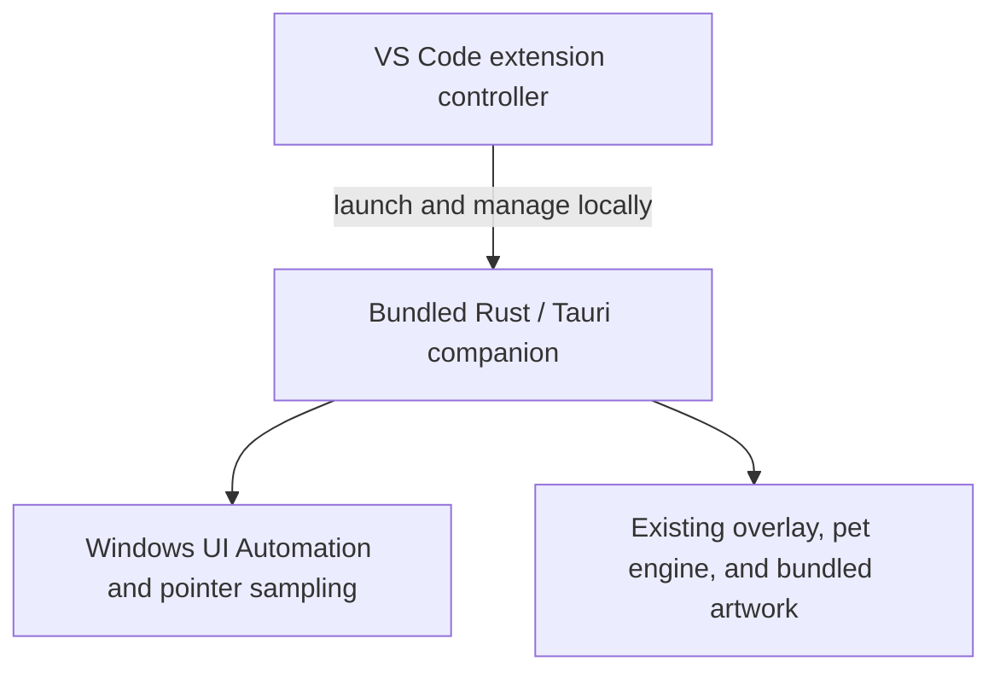

# VS Code extension: research and implementation tracker

Research date: 2026-10-24. Code reviewed: `e331f71` plus the current working tree. Status: research and proposed implementation; no extension package has been built, runtime-validated, or submitted to the Marketplace.

Expanded documentation review: Context7 `/websites/code_visualstudio_api`, `/microsoft/vscode-docs`, and `/tauri-apps/tauri-docs`, cross-checked against the [official API entry point](https://code.visualstudio.com/api) and linked references below. Context7 supplied the official testing guide when direct fetching of that page timed out. This document is the implementation tracker; do not create parallel planning documents.

## Goal and acceptance boundary

Make Socrates installable through the VS Code Marketplace while preserving the current Windows cat experience: walking on real IDE ledges, falling when support disappears, pointer reactions, click-and-hold carrying, click-through behavior, focus tracking, and all existing animations.

Keep one Rust/Tauri companion, one TypeScript pet engine, and one artwork set. Add a small VS Code extension that distributes and manages a production build of that companion. Identical behavior is the acceptance target, not a verified result of this investigation.

| Environment | Initial scope |
|---|---|
| Windows x64, desktop VS Code | Proposed first extension target; validate supported Windows/VS Code versions before release |
| Windows desktop VS Code connected to SSH, WSL, or a container | Companion must run locally beside the UI; explicitly test this configuration |
| Windows ARM64 | Deferred until a native package and runtime behavior are validated |
| Browser-only VS Code | Outside initial scope; cannot launch the native companion |
| Linux/macOS | Outside initial extension milestone; require working native integrations first |
| Existing Windows source launches in VS Code and Cursor | Preserve as regression targets |
| Cursor extension distribution | Separate compatibility/distribution investigation; not implied by a VS Code Marketplace listing |

Linux research remains in [linux_support.md](linux_support.md). Packaging this application as an extension does not supply missing Linux or macOS window/input APIs.

## Reuse strategy and clone compatibility contract

**Yes: build the existing application as an executable and distribute it through a thin extension.** Tauri already performs the native compilation and frontend embedding. An executable alone is not a VS Code extension: the VSIX also needs a manifest and a JavaScript controller. Packaging needs no replacement renderer or new native framework.

The current developer guide already documents this command, run from `companion/`:

```powershell
npm run tauri -- build --no-bundle
```

It builds the release application using the existing frontend hook while skipping installer generation. With the default Cargo target directory and no explicit target triple, expect `companion/src-tauri/target/release/companion.exe`; verify the actual output path rather than hard-coding it across scripts. This command has not been run as part of planning. [Existing build command](companion/README.md), [Tauri distribution](https://v2.tauri.app/distribute/), [Tauri CLI](https://v2.tauri.app/reference/cli/#build).

Required invariants throughout implementation:

- `npm ci`, `npm link`, `socrates`, `npm start`, `socrates --debug`, `socrates --check-updates`, and direct Tauri development commands retain their documented behavior.
- Cloning/running the application does not require installing extension development packages or enabling an extension.
- Preserve existing CLI validation, Ctrl+C handling, journal presentation, log paths/retention, optional update checks, environment precedence, and VS Code/Cursor host detection.
- Preserve the existing pet state machine, assets, geometry event shapes, revision/sequence handling, pointer timing, overlay flags, and foreground-window behavior.
- Extension lifecycle code activates only through an explicit managed launch option. No managed option means no new server, ownership lock, startup watchdog, or shutdown rule in source launches.
- Extension child environment changes are per-process; never mutate the user's shell, global environment, git configuration, or source-launch defaults.
- Building/packaging must not rewrite the pet manifest, shared source configuration, source package version, or repository artwork.
- Source tooling is supported code, not legacy merely because it is excluded from a VSIX. Keep it tested and reachable. Remove obsolete implementation paths only after their callers are migrated and both supported launch routes pass.

Functional equivalence means matching user-visible behavior on equivalent Windows/IDE configurations. The source workflow still builds through Vite/Cargo; an installed extension uses prebuilt output. Installation, activation, and diagnostics presentation can differ without changing the cat's behavior.

## Research findings

### The current stack is compatible with the proposed design

| Component | Role in an installed extension | Remaining concern |
|---|---|---|
| Windows UI Automation | Existing companion reads real IDE geometry | Windows-only; accessibility-tree changes and process privilege boundaries still apply |
| Rust | Precompiled native executable included in the extension | Architecture targeting, release build validation, process ownership |
| Tauri / WebView2 | Existing transparent native overlay and frontend host | WebView2 availability and production configuration |
| Vite | Build-time frontend bundler | Ensure all artwork and frontend assets work without the source checkout or development server |
| TypeScript | Existing pet engine plus a small extension controller | Compile extension code for the supported VS Code runtime |

Desktop extensions can run external processes. Therefore, launching the native companion is supported at the extension-runtime level; this is not proof that a particular package will pass Marketplace review. [Extension runtime capabilities and protections](https://code.visualstudio.com/docs/configure/extensions/extension-runtime-security).

Vite produces a static production bundle, and Tauri supports consuming that bundle through `frontendDist`. End users should not need Node, Rust, Cargo, Vite, or a repository checkout. WebView2 remains a runtime dependency. [Vite production builds](https://vite.dev/guide/build.html), [Tauri Vite integration](https://v2.tauri.app/start/frontend/vite/), [Tauri Windows distribution](https://v2.tauri.app/distribute/windows-installer/).

UI Automation remains an external Windows integration. It does not become direct access to VS Code's internal DOM. Windows privilege restrictions remain applicable; do not introduce administrator elevation or the special `uiAccess` flag as a shortcut for compatibility problems. [Windows UI Automation security](https://learn.microsoft.com/en-us/windows/win32/winauto/uiauto-securityoverview).

### Why a webview port does not meet this goal

The supported extension API does not expose VS Code's UI DOM. A webview supplies an isolated view in a panel, sidebar, or editor area, so it cannot reproduce a transparent cat roaming across all real workbench edges. [Extension restrictions](https://code.visualstudio.com/api/extension-capabilities/overview), [webviews](https://code.visualstudio.com/api/extension-guides/webview).

[VS Code Pets](https://marketplace.visualstudio.com/items?itemName=tonybaloney.vscode-pets) establishes a Marketplace precedent for animated pets, but does not validate Socrates's native-overlay implementation. A panel-only mode is a separate future product decision, not a fallback that satisfies this parity target.

### Marketplace requirements to track

- Register a publisher and package a VSIX with `@vscode/vsce`; publish the initial native package for `win32-x64`.
- Supply manifest identity/version fields and an explicit `engines.vscode` range. Add the executable extension entry point, commands, and settings.
- Prepare listing documentation and license information. Use a suitable PNG icon and comply with listing-image restrictions.
- Expect malware/secret scanning and runtime checks. Marketplace signing of the VSIX is separate from Windows signing of the bundled executable.
- Use stable VS Code APIs. Experimental proposed APIs are unsuitable for this Marketplace release.
- Preserve source, artwork, and dependency license obligations. Assess privacy-policy requirements against actual data access and network behavior.

Sources: [publishing](https://code.visualstudio.com/api/working-with-extensions/publishing-extension), [manifest](https://code.visualstudio.com/api/references/extension-manifest), [security](https://code.visualstudio.com/docs/configure/extensions/extension-runtime-security), [proposed APIs](https://code.visualstudio.com/api/advanced-topics/using-proposed-api), [publisher agreement](https://cdn.vsassets.io/v/M187_20210610.3/_content/Visual-Studio-Marketplace-Publisher-Agreement.pdf).

Publisher verification is optional and currently requires six-month extension/domain track records plus verification/review. The current publishing guide announces global Azure DevOps PAT retirement on December 1, 2026; use current authentication guidance when implementing automation. Manual VSIX upload is also documented. Recheck these time-sensitive details before release. [Publishing guide](https://code.visualstudio.com/api/working-with-extensions/publishing-extension).

### Documentation rules that affect implementation

| Documented behavior | Planning consequence |
|---|---|
| Desktop UI extensions can run locally with remote workspaces | Use `extensionKind: ["ui"]`, a `main` entry, and no `browser` entry; verify install placement with SSH/WSL/container sessions. [Host guide](https://code.visualstudio.com/api/advanced-topics/extension-host) |
| Contributed commands activate extensions automatically on VS Code 1.74+ | Choose a tested minimum version, then omit redundant `onCommand` declarations where supported. No blanket `*` activation. [Anatomy](https://code.visualstudio.com/api/get-started/extension-anatomy) |
| `onStartupFinished` activates after startup | Only add it when implementing opt-in startup; activation must check the setting before starting a companion. [Activation events](https://code.visualstudio.com/api/references/activation-events) |
| Asynchronous cleanup must return a Promise from `deactivate`; asynchronous subscription disposals are not awaited | Keep a bounded shutdown/release function and return its Promise. Use subscriptions for ordinary synchronous resources; crash recovery must work without deactivation. [Lifecycle](https://code.visualstudio.com/api/references/activation-events), [ExtensionContext](https://code.visualstudio.com/api/references/vscode-api#ExtensionContext) |
| `application` configuration scope is user-only | Use this for any shared-cat preferences; do not let repository settings supply executable paths, arbitrary arguments, or control endpoints. [Configuration scopes](https://code.visualstudio.com/api/references/contribution-points#contributes.configuration) |
| Restricted Mode support depends on actual use of workspace content | Aim to declare full support after proving only bundled code and user settings are used; test an untrusted and an empty workspace. [Workspace Trust](https://code.visualstudio.com/api/extension-guides/workspace-trust) |
| Windows process termination through Node signals is abrupt | A `kill('SIGTERM')` call is not a graceful logging/shutdown protocol. Add explicit native shutdown and reserve forced termination for verified owned processes. [Node child processes](https://nodejs.org/api/child_process.html#subprocesskillsignal) |
| Tauri installer bundling can provision WebView2 | `--no-bundle` skips that installer flow. The VSIX must detect/report a missing runtime or provide an explicit supported setup path. [Windows distribution](https://v2.tauri.app/distribute/windows-installer/) |

## Libraries and tools: reuse before adding

Resolved versions observed in the existing lockfiles: Tauri Rust `2.12.4`, Tauri CLI `2.12.3`, TypeScript `6.0.3`, Vite `8.3.4`, and the application's direct `windows` crate `0.61.3`. Preserve the lockfiles and validate implementation APIs against those versions; latest documentation is not authorization for an upgrade.

| Dependency/tool | Needed for | Decision |
|---|---|---|
| Existing Tauri CLI, `tauri`, `tauri-build`, Vite, TypeScript | Native executable and embedded frontend | Already present; reuse |
| Existing `windows`, `uiautomation`, `sysinfo`, `serde`, `serde_json`, `chrono` | Desktop integration, data, diagnostics | Reuse; add only Windows API feature flags proven necessary for managed lifecycle |
| `vscode` API | Commands, settings, diagnostics, lifecycle | Supplied by VS Code at runtime; do not install the old `vscode` npm package or bundle an API implementation |
| `@types/vscode`, `@types/node`, `typescript` | Compile/type-check extension controller | Extension-only dev dependencies; versions must match the selected VS Code host/runtime |
| `@vscode/vsce` | List/package the Windows VSIX | Extension-only pinned dev tool |
| `@vscode/test-electron` | Launch selected VS Code builds for integration tests | Extension-only dev tool; use existing Node assertions/test conventions where possible |
| `@vscode/test-cli` | Optional official test runner convenience | Add only if it removes custom runner work; do not maintain two runner systems |
| Node built-ins: `child_process`, `path`, `fs`, `crypto`, possibly `net` | Process startup, staging, identification, local control | No added npm runtime library; use APIs available in the oldest supported extension host |
| WebView2 Runtime | Execute the Tauri frontend on Windows | End-user prerequisite; VS Code's Electron runtime does not substitute for it |

No Electron migration, Node executable packager, React UI, HTTP server, automatic updater plugin, shell plugin, generic RPC framework, or native Node binding is required by this design. A Tauri single-instance plugin is not automatically required either: first prove that it can meet ownership and source-isolation requirements before considering it. Prefer the existing native dependencies and a narrow control implementation.

Sources: [extension anatomy](https://code.visualstudio.com/api/get-started/extension-anatomy), [official extension test guide](https://github.com/microsoft/vscode-docs/blob/main/api/working-with-extensions/testing-extension.md), [publishing](https://code.visualstudio.com/api/working-with-extensions/publishing-extension), [Node IPC](https://nodejs.org/api/net.html#ipc-support).

## Existing implementation evidence

Locations use `startLine:endLine:filepath` and describe the reviewed revision; line numbers may move.

| Evidence | Implication |
|---|---|
| `88:115:companion/bin/socrates.js`, [launcher](companion/bin/socrates.js): resolves the Tauri CLI and starts `dev` | The extension needs a production launch path; do not run this development launcher on users' machines |
| `9:10:companion/src-tauri/tauri.conf.json`, [configuration](companion/src-tauri/tauri.conf.json): build hook and `frontendDist` already exist | Production packaging has a starting point, but requires validation |
| `21:22:companion/src-tauri/tauri.conf.json`: transparent, always-on-top native window | Retain the native overlay rather than moving rendering into a VS Code panel |
| `632:635:companion/src-tauri/src/lib.rs`, [native host](companion/src-tauri/src/lib.rs): always-on-top and ignored cursor events | Preserve overlay/input behavior |
| `8:11:companion/src/pet/pet-clips.ts`, [asset imports](companion/src/pet/pet-clips.ts): eager Vite asset URL imports | Verify sprite inclusion and resolution in the release artifact |
| `2:5:companion/src-tauri/src/main.rs`, [native entry point](companion/src-tauri/src/main.rs): Windows GUI subsystem for release | Validate diagnostics transport in release; do not assume development console behavior |

The [architecture guide](docs/architecture.md) describes UIA geometry, pointer polling, focus behavior, and privacy boundaries. Existing source launch defaults and behavior remain the regression baseline.

Additional coupling found during review:

- `companion/src-tauri/src/lib.rs` owns application startup, native workers, overlay registration, and the final log flush. It is the integration point for managed startup/shutdown; do not put process-control behavior in the pet engine.
- `runtime_log.rs` already emits structured stdout records and writes rotating journals. Reuse its record format/flush path; adding a second journal writer would duplicate responsibility.
- `habitat_config.rs` caches presentation settings once per process, and `main.ts` reads them at startup. Initially apply extension presentation changes on an explicit restart, or omit these settings; do not promise live updates without implementing their full path.
- The frontend tsconfig uses DOM libraries, bundler resolution, and `noEmit`. It is not the correct compiler configuration for a Node extension entry point.
- The source launcher tests copy the three current `bin/` modules into fixtures. Avoid extracting/rearranging them for extension reuse; any necessary extraction must update these callers/fixtures together.
- The current source updater reads `companion/package.json` metadata. Keep that package's name/bin/repository/update semantics intact.

## File-level change budget

| File/area | Planned treatment | Reason and verification |
|---|---|---|
| `companion/package.json`, lockfile | Preserve existing commands/dependencies; add a release alias only if it removes repeated commands | Clone install/run/tests remain independent of extension tooling |
| `companion/bin/*.js` and current launcher tests | Normally unchanged | Source launch, updates, and terminal logging remain supported |
| `companion/src-tauri/src/lib.rs` | Small managed-mode startup/shutdown wiring | Run source and managed lifecycle regressions |
| `companion/src-tauri/src/main.rs` | Normally unchanged | Preserve GUI subsystem and current native entry |
| `companion/src-tauri/src/runtime_log.rs` | Reuse; edit only for a demonstrated shutdown/transport gap | Preserve schemas, queue bounds, rotation, and source output |
| `companion/src-tauri/src/habitat_config.rs`, `ide_host.rs` | Prefer unchanged; managed launch supplies explicit inputs | Keep existing environment/CLI precedence and Cursor behavior |
| `companion/src-tauri/Cargo.toml`, lockfile | Only lifecycle API features/dependencies justified by the selected design | No dependency-version churn or platform refactor |
| Tauri config, capabilities, `build.rs`, Vite config | Reuse; edit only if the release spike proves a packaging problem | Do not weaken CSP or add broad permissions to make packaging pass |
| `companion/src/`, `surface_mapper.rs`, artwork | Expected unchanged | Existing rendering, simulation, and UIA logic are the feature being distributed |
| `.gitignore` | Reuse `dist/`, `target/`, and `*.vsix` rules; add only uncovered generated paths | No tracked binaries/caches or overlapping ignore systems |
| Existing README/developer guide/architecture/changelog | Update once behavior and release commands are real | Keep source instructions accurate; distinguish source and extension routes |

Justified new implementation files, created only in their phase:

- `extension/package.json` and lockfile: independent manifest/tooling boundary so clone users do not install VS Code tooling. Do not turn the repository into an npm workspace merely for this feature.
- `extension/tsconfig.json` and `extension/src/extension.ts`: compile a small Node-compatible entry; start with one controller, then extract only cohesive logic needed for tests/readability.
- One extension packaging script and focused tests: stage generated runtime files under `extension/dist/`, verify contents, and avoid shell-specific copy pipelines. Use a single file-inclusion strategy supported by the pinned `vsce` version; do not keep conflicting allowlists and ignore lists.
- At most one focused native managed-lifecycle module if control/ownership code would otherwise obscure `lib.rs`. This is a real new responsibility, not a reason to split existing UIA/rendering code.
- One extension-specific listing README if source-install documentation cannot accurately describe the installable product. Generate/copy licenses, icon, and release assets from their existing canonical sources.
- One Windows build workflow when the release path is proven; do not create scaffolding or unused automation in advance.

Editing an existing file is preferred when it already owns the responsibility. A separate extension manifest and Node compiler configuration avoid invasive edits to the working companion and are justified even though they are new files.

## Proposed architecture and decisions



- Add a dedicated extension package, tentatively `extension/`, without duplicating the companion sources or pet assets.
- Declare `extensionKind: ["ui"]` so the controller runs beside the desktop UI, including remote-workspace sessions. Browser-only execution is excluded. [Extension host placement](https://code.visualstudio.com/api/advanced-topics/extension-host), [web limitations](https://code.visualstudio.com/api/extension-guides/web-extensions).
- Bundle a matching production companion with each extension release. Start with bundled delivery rather than runtime executable downloads or a second updater.
- Launch the executable directly using an argument array and controlled settings. Do not construct shell command strings or resolve the executable from the workspace/PATH.
- Set the VS Code host explicitly for extension launches. Keep source-launch host selection intact.
- Proposed initial commands: Start, Stop, and Show Diagnostics. Automatic startup should be an explicit preference, initially off.
- Proposed ownership: one extension-managed companion per Windows user/interactive session for the supported VS Code product, following foreground VS Code windows as the current app does. Do not scope ownership to workspace, extension-host PID, or installed extension version: each can differ across windows that share the same desktop.
- Keep ownership separate from independently launched source companions. Never stop arbitrary processes by executable name.
- Reuse native logging; adapt the extension's diagnostics view to the release build. Add only the control/health transport needed for the chosen lifecycle design.
- Store mutable state/logs outside the extension installation directory. Define how the running executable is released during updates on Windows.

These choices are proposals until their implementation checkboxes and validation gates are completed.

### Managed lifecycle: narrow protocol, explicit ownership

The current application has no external graceful-stop interface. A reliable installed extension needs a small addition here even though the pet engine can be reused unchanged.

Preferred design to prove in phase 2: the companion owns a local Windows named-pipe endpoint; each active extension window holds a client connection representing its ownership interest. An atomic native ownership primitive prevents simultaneous starts from creating two overlays. Reuse Node `net` and existing Windows crate APIs where practical. No separate broker service or TCP listener. [Node named pipes](https://nodejs.org/api/net.html#ipc-support), [Windows pipe access controls](https://learn.microsoft.com/en-us/windows/win32/ipc/named-pipe-security-and-access-rights).

| Event | Required result |
|---|---|
| Start with no managed instance | Acquire startup ownership; start exactly one executable; acknowledge native readiness within a bounded timeout |
| Two windows start concurrently | One process wins; the other attaches to the verified endpoint; losing startup attempts exit before showing an overlay |
| Start when an instance exists | Attach without restarting animation/physics; return companion version, protocol version, and state |
| One window closes/deactivates | Release only that window's interest; other connected owners retain the cat |
| Last owner disconnects or crashes | After a short, measured reconnect grace period, native process exits through its normal lifecycle |
| Explicit Stop | Stop the shared managed cat for the current session; connected controllers suppress automatic reconnect/relaunch until a new explicit Start or a new permitted startup session |
| Reload while another owner remains | Reattach without disturbing the cat |
| Companion crash/startup failure | Report failure and release resources; no infinite restart loop |
| Protocol/version mismatch during upgrade | Refuse incompatible attachment; offer a controlled restart, without launching a duplicate or repeatedly replacing each other's versions |
| Missing/blocked executable or WebView2 | Fail with an actionable message and a useful diagnostic; do not silently compile/download a replacement |
| Independent source companion running | Do not adopt, terminate, or alter it. Detect only if reliable identity can be established; otherwise document simultaneous independent launches rather than claiming perfect duplicate prevention |

An ordinary GitHub source launch must never join this protocol. Duplicate prevention applies to extension-managed instances; preserving independent source behavior means the extension cannot impose a global singleton on all existing launches.

Before implementing, pin down these protocol details in this document:

- Explicit managed launch marker and versioned handshake; no editor-text or generic command-execution messages.
- Minimal operations: attach/status, release, and stop. Settings that require a restart do not need a live configuration RPC.
- Current-user/session endpoint access, bounded message sizes, bounded client count, timeouts, ownership verification, and stale-start recovery. A pipe name alone is not authentication; do not rely on permissive default Windows pipe access controls.
- Bound/release OS handles, clients, listeners, timers, and worker threads. Dispose/release must be idempotent. A failed setup must unwind all partially acquired resources.
- Native readiness means the runtime/control path is ready; distinguish this from waiting for a visible IDE window. Never treat successful process spawning alone as successful startup.
- Native graceful exit must flush diagnostics and close control resources. Confirm the existing locked Tauri version's lifecycle behavior before changing `.run(...)`; current Tauri documents `AppHandle::exit` events, but the latest API page is not the lockfile. [Tauri lifecycle reference](https://docs.rs/tauri/latest/tauri/struct.AppHandle.html#method.exit).
- Forced shutdown may target only a verified managed process after timeout. Never kill all `companion.exe`, `Code.exe`, or WebView2 processes, and never use a stale PID alone as identity.

If named-pipe ownership proves disproportionately complex, compare one concrete simpler design against the same acceptance table before choosing. A parent-watch-only or stdin-only design cannot by itself preserve a shared companion when the first owner exits. Ship one selected mechanism; remove the rejected spike and do not retain dormant fallback transports.

### Upstream and downstream effects

| Proposed change | Upstream inputs/assumptions | Downstream effects to verify |
|---|---|---|
| Native release build | Existing npm/Cargo locks, frontend hook, Rust target, production CSP | Asset URLs, WebView2 behavior, logging pipes, runtime DLL requirements, working-directory independence |
| Managed launch option | Validated extension-owned arguments and environment | Normal launches remain unmanaged; configuration defaults and startup order remain unchanged |
| Explicit `HABITAT_IDE_HOST=code` for extension child | Installed extension is scoped to supported VS Code | Cursor source launch and foreground matching remain unchanged |
| Ownership/control | Multiple hosts, process crash/disconnect, user/session identity | One managed cat, safe shutdown, no source-process interference, upgrade compatibility |
| Logging reuse | Existing stdout format, queue, session identifiers, native file writer | Release GUI subsystem output, pipe closure after original owner exits, rotation/retention, diagnostic readability |
| Storage choice | VS Code global storage/log APIs, possibly different profiles and versions | Do not use workspace folders; keep managed logs separate from source logs and prevent multiple writers rotating one file |
| Extension preferences | User-level settings; native presentation is startup-cached | No workspace execution inputs; explicit restart semantics; conflicting profile settings do not trigger restart loops |
| VSIX staging | One known native artifact and extension compile output | No stale executable, duplicate loose artwork, source caches, or development toolchain shipped |
| Upgrade/removal | Old executable can be locked on Windows; another window may still use it | Controlled handoff, bounded old-artifact cleanup, correct owner release; source checkout/logs untouched |
| Future Linux integration | Same native startup boundary may change later | Keep management Windows-gated; coordinate shared-file edits without introducing speculative cross-platform layers |

Logging/storage decisions should remain small: use the existing native journal writer in a verified extension-owned directory and expose it through Show Diagnostics. Add live streaming only if it earns its complexity. If per-instance directories are needed, define bounded cleanup restricted to that owned root; native file rotation alone does not prune abandoned directories. Do not duplicate the source launcher's development-output pipeline.

## Implementation phases

Each phase must leave usable, tested code. Remove disposable spike code before the next phase; the final cleanup audit does not excuse accumulating unused paths. No implementation work or application tests have been performed by this planning update.

### Phase 0 — freeze the source contract and establish baseline

**Files:** existing code/tests/docs for inspection; record evidence here. No architecture refactor.

- [ ] Record source revision, lockfile versions, Windows/VS Code/Cursor versions, display configuration, baseline CPU/memory, and representative behavior clips.
- [ ] Run current frontend/native tests and frontend build; distinguish pre-existing failures from feature regressions.
- [ ] Exercise all source commands in the compatibility contract, including debug flags, optional updates, an unrelated working directory with spaces, and Ctrl+C shutdown.
- [ ] Map launcher/native/frontend callers and confirm the expected unchanged areas in the file budget.
- [ ] Inventory existing dead/unreferenced candidates in the affected paths; verify real callers before deletion. Do not delete configuration/API exports simply because a text search misses framework use.

**Exit gate:** recorded baseline and explicit regression checks. Do not promise source compatibility based only on avoiding edits to the launcher.

### Phase 1 — prove executable reuse with the existing toolchain

**Files:** prefer no source edits; only narrow existing build/config fixes justified by failures.

- [ ] Run the existing Tauri release command. Verify Cargo lock enforcement/argument forwarding with the installed CLI before codifying the reproducible build command.
- [ ] Verify the resulting executable's architecture, actual output path, embedded frontend/artwork, and any required adjacent runtime files. Do not assume a single EXE is sufficient until checked.
- [ ] Run it outside the checkout, from paths with spaces/non-ASCII characters and without a Vite server.
- [ ] Compare production CSP, sprite loading, focus/geometry, animations, carrying, and structured logs against source launch.
- [ ] Test a clean Windows machine with no Node/Rust/build tools. Check WebView2 present, absent, and unsupported-runtime cases; select an actionable prerequisite flow without silent installation/elevation.
- [ ] Record release size, cold/warm launch times, idle/active CPU/memory, and any differences caused by release optimization or the GUI subsystem.
- [ ] Re-run source regressions for any shared fixes; remove experiment-only configuration.

**Exit gate:** standalone production application matches the baseline. Stop and fix a release-path defect before building an extension around it.

### Phase 2 — implement the smallest reliable native managed lifecycle

**Files:** small wiring in `lib.rs`, one focused managed module if justified, minimal Cargo API features, native tests; logging changes only where necessary.

- [ ] Finalize endpoint identity, managed launch marker, handshake/version rules, ownership interest, Stop semantics, timeouts, and profile/version conflicts above.
- [ ] Implement atomic ownership before starting UIA workers or displaying an overlay; make concurrent losers exit cleanly.
- [ ] Implement bounded attach/status/release/stop and source-mode bypass using the existing dependencies where practical.
- [ ] Implement graceful native exit and crash/disconnect recovery independent of VS Code `deactivate`.
- [ ] Verify log flushing, broken/closed stdout pipes, blocked control clients, disk errors, and teardown of all introduced resources.
- [ ] Add meaningful native tests for concurrent start, disconnect races, last-owner exit, malformed/oversized requests, stale ownership, version mismatch, and unmanaged behavior.
- [ ] Remove rejected transports/locks/watchdogs and unused test harness branches immediately.

**Exit gate:** lifecycle acceptance table passes with a small test client; source launches acquire no managed ownership and retain existing shutdown behavior. The test client is either a maintained test fixture or removed, never shipped as a second launcher.

### Phase 3 — add the thin VS Code controller

**Files:** extension manifest/lock/compiler configuration, one entry/controller, focused tests; existing native hooks only if a proven integration gap appears.

- [ ] Select a minimum VS Code version and compatible Node/VS Code types. Use a plain compiled Node entry; start without an extra JS bundler.
- [ ] Contribute Start, Stop, and Show Diagnostics, with `main` and `extensionKind: ["ui"]`; omit unused commands, views, browser entry points, and permissions.
- [ ] Resolve the executable from the installed extension directory; launch directly with an argument array, `windowsHide`, and a controlled working directory/environment. No shell, workspace executable, or `process.execPath` assumption for a standalone Node runtime.
- [ ] Attach to an existing managed instance or start one; await readiness and verify version/identity. Serialise overlapping Start/Stop actions within each controller as well as across processes.
- [ ] Dispose registrations/listeners/output resources; return bounded asynchronous release from `deactivate`.
- [ ] Expose existing native logs with bounded output and clear missing-runtime/failed-start diagnostics. Do not create a second journal format.
- [ ] Add only preferences that have complete behavior. If auto-start is included, default off, use user-only scope and `onStartupFinished`, and respect explicit Stop without a restart loop.
- [ ] Verify workspace trust, no-folder startup, remote workspace placement, and presentation restart semantics. Do not accept arbitrary environment or executable overrides from workspace settings.
- [ ] Exercise the actual extension API in the Extension Development Host with the official testing tooling; use Node tests for the process/control logic.

**Exit gate:** controller works with the production companion, all commands have real handlers, all settings have real consumers, and clone users require none of these tooling packages.

### Phase 4 — package a repeatable Windows VSIX

**Files:** one packaging script, manifest build/file-inclusion settings, existing ignore rules as needed; a Windows CI workflow only after local reproducibility.

- [ ] Define one pipeline: locked companion install/build, locked extension install/compile, runtime/license staging, VSIX content inspection, platform-targeted packaging.
- [ ] Stage generated files under a verified dedicated output root. Clean only this root with safe literal-path operations; never recursively clean a computed parent or the source checkout.
- [ ] Reuse the existing asset embedding. Do not copy loose sprites into the VSIX unless a demonstrated runtime requirement exists.
- [ ] Identify the native build/version inside the package and fail on missing/stale/wrong-architecture output; keep extension and companion versions deliberately associated without rewriting source versions on every package run.
- [ ] Use the pinned `vsce` tool to inspect and package `win32-x64`. Exclude source build trees, logs, caches, raw development tooling, private material, and unrelated artwork.
- [ ] Test packaging from a clean checkout and another working directory. Verify package contents and hashes/provenance for the bundled executable.
- [ ] Install the VSIX on a clean desktop and exercise it outside the Development Host.
- [ ] Test upgrading, disabling, and uninstalling with multiple windows and a running executable; resolve Windows locks without broad process killing or accumulating old artifacts.

**Exit gate:** a reproducible installable artifact passes clean-machine and lifecycle checks. No publishing yet.

### Phase 5 — full behavior parity and upstream/downstream regression gate

**Files:** extend existing regression tests where behavior was touched; extension integration tests and this evidence table. No new feature scope.

- [ ] Run every row below against the source baseline and installed VSIX; record results, versions, and evidence.
- [ ] Re-run clone install/link/start/debug/update/exit workflows in both VS Code and Cursor after all shared changes.
- [ ] Fault-test concurrent starts, host crashes, disk errors, inaccessible assets, stale ownership, version conflicts, and upgrade/removal.
- [ ] Confirm stdout consumers, logging retention, active native workers, extension listeners, and timers have correct shutdown paths.
- [ ] Measure resource impact and set explicit acceptable limits from phase 0 observations; investigate regressions rather than silently reducing behavior.

**Exit gate:** no unresolved source regressions, no unowned managed processes, and evidence for supported configurations. A successful build is insufficient.

| Check | Pass criteria | Result/evidence |
|---|---|---|
| Real ledges | Tabs, panel edges, status bar, moving splits, and disappearing support behave as in source launch | Pending |
| Animation/physics | Existing walks, turns, falls, grooming, sleep/dream sequences, portals, and divider behavior remain intact | Pending |
| Pointer/carrying | Reactions, hold timing, swing, release, and landing match baseline; clicks still pass through | Pending |
| Focus/windows | Foreground-window tracking, hiding, minimize/restore, and multi-window transitions match baseline | Pending |
| Display geometry | Window moves/resizes, mixed DPI, multiple monitors, maximization, and supported full-screen layouts work | Pending |
| Release environment | Works without checkout/dev tools; no localhost development server required | Pending |
| Lifecycle | Repeated commands, reload, crash recovery, shutdown, upgrade, and removal meet ownership rules | Pending |
| Remote workspaces | Overlay stays on the local Windows desktop; no remote companion starts | Pending |
| Source compatibility | Existing Windows VS Code and Cursor source workflows remain functional | Pending |
| Resource use/privacy | Measured overhead is acceptable; no new editor-text collection or undisclosed network behavior | Pending |

Run existing frontend and native checks from `companion/` when implementation touches relevant behavior:

```powershell
npm test
npm run build
cargo test --locked --manifest-path src-tauri/Cargo.toml
```

Add focused tests for extension process ownership, launch validation, and recovery. Test an installed release VSIX in addition to the Extension Development Host. Record versions and evidence in the table; do not mark parity complete from a successful build alone.

### Phase 6 — release readiness and documentation

**Files:** existing docs plus the extension listing assets/manifest and established packaging automation.

- [ ] Finalize publisher/extension IDs, supported environments, runtime prerequisites, native signing decision, and license/attribution inclusion.
- [ ] Recheck current Marketplace rules and authentication; prepare publication without submitting or creating credentials during planning.
- [ ] Update the root README and companion guide with distinct source and extension instructions; preserve all working clone commands.
- [ ] Update architecture/changelog with the actual lifecycle, log/storage locations, and measured limitations; avoid unsupported parity/platform claims.
- [ ] Prepare accurate listing screenshots, support/privacy information, and release notes.
- [ ] Confirm the release path performs no implicit git commit, tag, push, or publish. Publication requires explicit user authorization after the final cleanup gate.

**Exit gate:** release candidate and documentation are reviewable. Public release must wait for phase 7.

### Phase 7 — final cleanup: cleanliness, completeness, and minimalism

**This is the final implementation phase and a release blocker.** No dead, orphaned, superseded, or unused implementation code may remain in the feature or its affected integration paths. Existing supported clone tooling remains live functionality and must not be misclassified as obsolete.

- [ ] Review every added/edited file, function/export, command, setting, environment variable, dependency, native feature flag, build step, and test fixture. Each must have a current caller, consumer, or explicit framework contract.
- [ ] Trace imports, Tauri command registrations, VS Code contributions, scripts, and assets end to end. Remove orphaned registrations and stale callers together.
- [ ] Remove prototype clients, abandoned transports, duplicate launchers/renderers/journal writers, unused compatibility branches, disabled code, commented-out experiments, temporary assets, and obsolete scripts/configuration.
- [ ] Remove unused dependencies/dev tools/native features. Delete only those proven unnecessary; update the relevant lockfile without unrelated upgrades.
- [ ] Consolidate repeated checks only where doing so reduces total complexity. Avoid one-use abstraction layers, generic managers, speculative platform adapters, and a second copy of canonical artwork/configuration.
- [ ] Inspect all new resource owners: timers, listeners, output channels, pipes, OS handles, workers, pending requests, and generated files. Every normal/error/crash path must release, expire, or recover them.
- [ ] Confirm source tooling and the source-only updater remain intact and tested, but are excluded from installed extension execution. There must be only one updater path for each supported distribution.
- [ ] Run existing TypeScript unused-symbol checks and native warnings/lints appropriate to touched code. Record pre-existing unrelated findings separately; no broad warning suppressions or speculative deletions to get a green check.
- [ ] Check that only justified new files remain and existing responsibility owners were edited where possible. Remove empty scaffolding, duplicate docs, and TODO-only interfaces.
- [ ] Rebuild from a clean staging directory; re-inspect the final VSIX to prove excluded/generated leftovers are gone.
- [ ] Re-run tests and smoke checks affected by cleanup, including clone and installed-extension startup/shutdown. Preserve phase 5 evidence for unchanged behavior and revalidate where cleanup changes execution.
- [ ] Review the final diff for scope, caller compatibility, source instructions, claims, links, and whitespace. Record completion evidence here.

**Exit gate:** minimal reviewed diff, all source/extension gates passed, no unexplained leftovers, and a validated final artifact. Only then may an explicitly authorized publication occur. Record its URL/version afterward; publishing is not permission to skip cleanup.

## Open decisions and risks

| Item | Resolution needed |
|---|---|
| Exact parity | Production and installed-extension evidence from phases 0–5 |
| Multi-window coordination | Smallest reliable ownership/health mechanism, including unexpected host termination |
| WebView2 missing/outdated | Supported prerequisite flow and tested minimum runtime |
| Native signing | Signing approach, cost, and behavior under Windows security products; Marketplace listing is not an exemption |
| UIA compatibility | Tested VS Code releases/layouts and behavior when geometry becomes unavailable |
| Elevated IDE | Define supported privilege configuration; do not promise cross-integrity access |
| Package size/performance | Measure actual release artifact and compare runtime metrics to the source baseline |
| Updates/uninstall | Windows executable locks, shared ownership, process exit, and retained user logs/settings |
| Marketplace acceptance | Validate the actual submitted package; technology feasibility is not preapproval |

## Progress log

- 2026-10-24: Inspected the current launcher, Tauri production configuration, native overlay/UIA integration, and Vite asset imports. Reviewed official extension/runtime/publishing and Tauri documentation. Selected native-companion packaging as the proposed route for preserving functionality. All implementation and runtime validation remain pending.
- 2026-10-24: Reviewed official documentation through Context7 and the VS Code API site. Expanded the plan with a clone compatibility contract, existing-toolchain executable build path, dependency budget, file-level edits, lifecycle design, upstream/downstream effects, and phases 0–7 ending in a mandatory cleanup gate before publication. No application code, dependencies, builds, or runtime tests changed/run.
